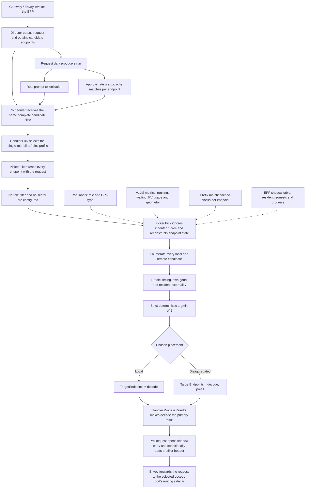
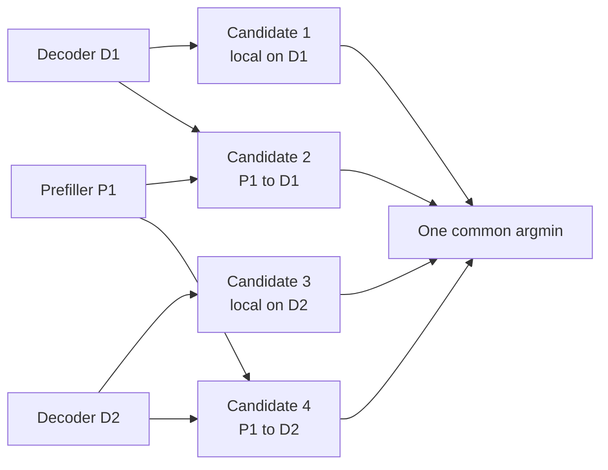
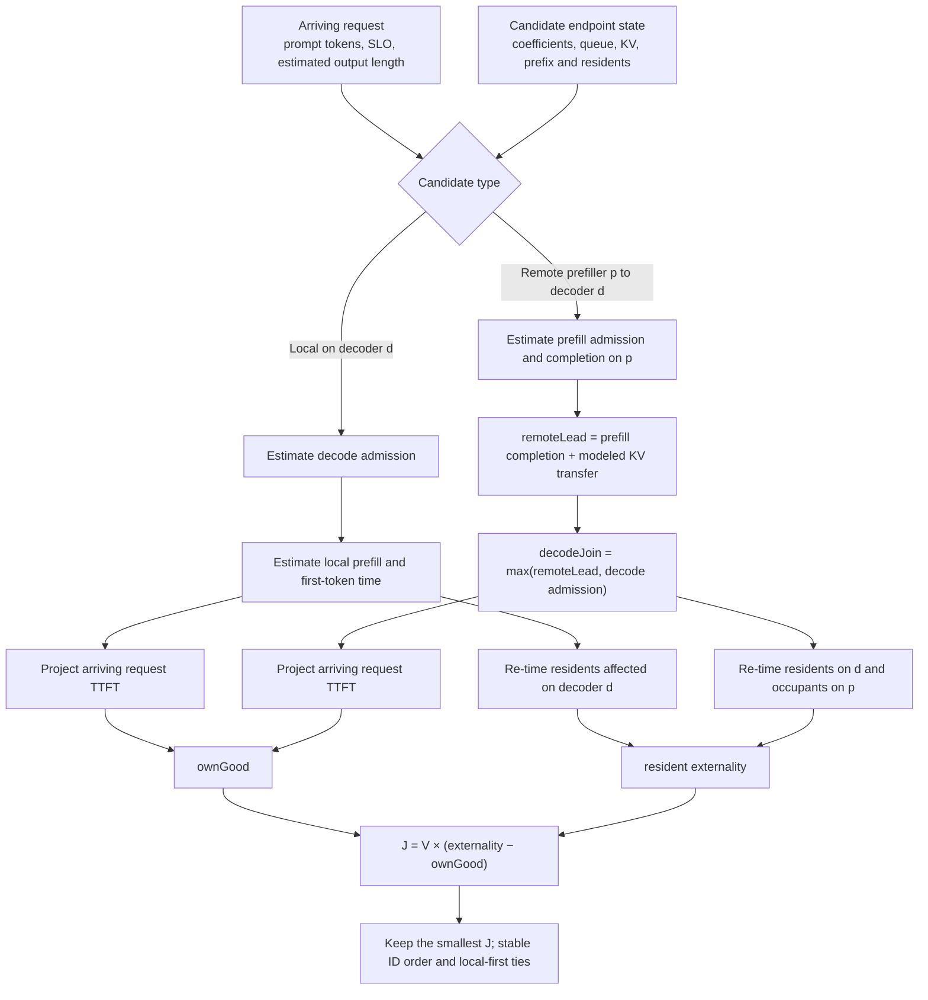
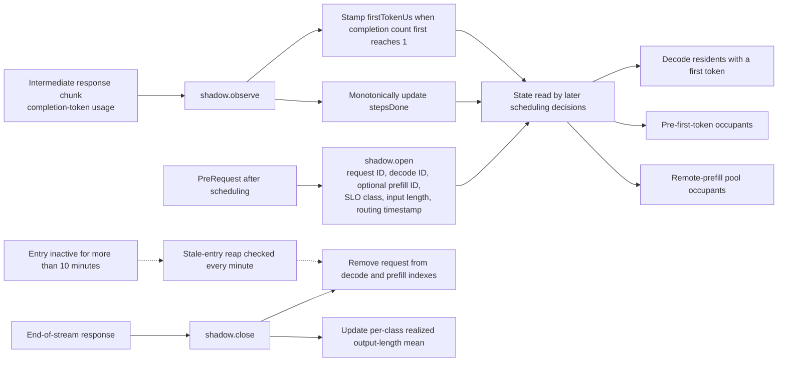
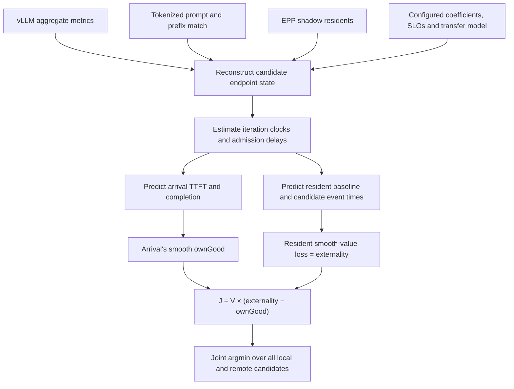

# How the INFOCOM P/D Algorithm Is Ported to llm-d

The short version is: your teammate is not translating the entire BLIS simulator into llm-d. He is extracting the routing decision from the simulator and reimplementing it as a scheduling plugin inside llm-d’s Endpoint Picker/Processing service (EPP).

The resulting plugin answers one question for each incoming request:

> Which decode pod should serve this request, and should its prefill run locally on that decoder or remotely on a prefill pod?

Everything after that decision—creating the prefill subrequest, transferring KV state, and running decode—is handled by llm-d, its routing sidecar, vLLM, and NIXL.

## Source-verified implementation figures

These figures were checked against clean source trees at:

- Transfer bundle commit `2f4fa111029cae360b07c797ca321647b5ce8543`.
- Generated translation `07f0062216a475f9d9931fd8f752b11dc25ea52abdd38dc76dea7382482297ba`.
- llm-d-router commit `5f4e762f341a5196393ce79f8a57c3e1900c4a6b`.

The figures distinguish three things that are easy to conflate: the EPP control-plane decision, the policy's mathematical prediction, and the vLLM/NIXL data-plane execution.

### Figure 1: How one request is scheduled inside the EPP



The absence of role filters in the `joint` profile is deliberate. Every scheduler profile receives the same candidate slice. The custom filter preserves that slice and attaches the request to each endpoint because the standard `Picker` interface receives scored endpoints but not the request itself.

The standard scorer stage initializes every endpoint's inherited score to zero because this profile has no scorers. The custom picker explicitly ignores that score and computes the signed, unbounded joint objective itself. This avoids the framework's normal scorer clamp to `[0,1]`.

### Figure 2: What the joint picker evaluates

For the configured 1-prefiller/2-decoder topology, the candidate set is:



In general, the intended single-role deployment produces `D` local candidates plus `D × P` disaggregated candidates. The source also handles dual-role endpoints: it skips a remote `(d,p)` pair when `d` and `p` are the same endpoint because that is already the local candidate.

Every candidate is scored through the following calculation:



Two source-level details matter here:

1. Remote prefill and decode-queue drainage are concurrent clocks. The code computes `decodeJoin = max(remoteLead, decodeAdmission)`; it does not add the complete decode wait after remote prefill.
2. Transfer is already priced through `remoteLead`, which affects TTFT and the interference window. There is intentionally no second standalone transfer penalty.

### Figure 3: How the selected placement executes in the serial NIXLv2 path

```mermaid
sequenceDiagram
    autonumber
    participant C as Client
    participant G as Gateway / Envoy
    participant E as EPP
    participant S as Selected decode-side sidecar
    participant P as Prefill vLLM
    participant D as Decode vLLM

    C->>G: OpenAI request
    G->>E: External-processing request
    E->>E: Run joint picker
    E-->>G: Decode target and optional prefiller header
    G->>S: Forward to selected decode endpoint

    alt Local placement: no prefiller header
        S->>D: Forward original request
        D->>D: Local prefill, then decode
    else Disaggregated placement: prefiller header present
        S->>S: Remove and validate prefiller header
        S->>P: Non-streaming prefill request; maximum-output fields capped at 1; remote-decode KV parameters
        P-->>S: Prefill response with kv_transfer_params and cached-token usage
        S->>D: Original maximum-output fields and streaming restored; attach prefiller kv_transfer_params
        P-->>D: KV cache through the vLLM NIXL connector and a viable UCX transport
        D->>D: Decode using transferred KV
    end

    D-->>S: Streamed completion
    S-->>G: Streamed completion
    G->>E: Response-body callback for each chunk
    E->>E: Update progress and first-token shadow state
    G-->>C: Streamed completion
```

The solid HTTP control sequence through the sidecar is implemented in llm-d-router. The KV-data arrow is the contract established by the `kv_transfer_params` passed between vLLM engines; the actual tensor movement is implemented by vLLM/NIXL, outside the router repository.

For the OpenAI chat/completions path at this pinned router commit, the prefill rewrite caps the maximum-output fields but does not cap or remove `min_tokens`. A request carrying `min_tokens > 1` can therefore fail at the prefill step even though the sequence above is otherwise correct. The separate token-in generate API does include `min_tokens` in its capped field set.

The UCX transport is not necessarily TCP for every request. With an allow-list such as `sm,cuda_ipc,cuda_copy,tcp`, colocated engines may use shared-memory or CUDA-IPC paths, while cross-node transfers generally use TCP. RDMA would require an RDMA-capable UCX transport such as `rc` plus the necessary cluster networking.

### Figure 4: Why the EPP maintains a shadow table



The shadow table is not a copy of vLLM's scheduler. It supplies request-level details that vLLM metrics do not expose, while aggregate engine state still comes from metrics. This is why the deployment requires one EPP replica and why per-chunk usage is necessary.

### Source map for the figures

| Figure claim | Verified source |
|---|---|
| Profile handler, filter, scorer and picker interfaces | `llm-d-router/pkg/epp/framework/interface/scheduling/plugins.go` |
| All profiles receive the same endpoint slice | `llm-d-router/pkg/epp/scheduling/scheduler.go` |
| Filter → scorer → picker order and `[0,1]` scorer clamp | `llm-d-router/pkg/epp/scheduling/scheduler_profile.go` |
| Registration of the generated handler and picker | `generated/causalsloexternality/cmd/epp/runner/runner.go` |
| Role-blind filter, state reconstruction, output endpoint order | `generated/causalsloexternality/.../causalsloexternality/plugin.go` |
| Local and cross-product enumeration, timing equations and objective | `generated/causalsloexternality/.../causalsloexternality/score.go` and `coeffs.go` |
| Request lifecycle and reconstructed resident state | `generated/causalsloexternality/.../causalsloexternality/shadow.go` |
| Primary decode routing and request-control hooks | `llm-d-router/pkg/epp/requestcontrol/director.go` |
| Sidecar branch on the prefiller header | `llm-d-router/pkg/sidecar/proxy/chat_completions.go` |
| Serial NIXLv2 prefill-response-decode sequence | `llm-d-router/pkg/sidecar/proxy/connector_nixlv2.go` |

The figures do not claim that the real engine state equals the simulator state, that a disaggregated choice will necessarily succeed, or that the configured transfer model matches the deployed fabric. Those are validation questions discussed later in this document.

There are therefore three different things involved in the “port”:

1. Porting the policy mathematics into an llm-d EPP plugin.
2. Connecting the plugin’s chosen `(decode, prefill)` pair to llm-d’s P/D machinery.
3. Creating a reproducible Kubernetes deployment and experiment around it.

Your teammate has made substantial progress on the first, partially validated the second, and is currently trying to make the third reproducible through sim2real.

## 1. What exists in the INFOCOM simulator

In the simulator, the algorithm has unusually rich information. It knows things such as:

- The exact ordered queue at every server.
- Every running request.
- How many tokens each request has generated.
- When each resident request will likely finish.
- Exact or highly detailed KV-cache occupancy.
- Cached-prefix state.
- Which GPU type each server has.
- Prefill and decode service-time models.
- The simulated network transfer model.
- Each request’s TTFT, ITL and E2E objectives.
- The future event timeline.

Using that state, the focal policy evaluates joint placements.

If there are decode pods \(D\) and prefill pods \(P\), its candidate set is approximately:

$$
\mathcal{C}
=
\{(d,\mathrm{local}) : d \in D\}
\cup
\{(d,p) : d \in D,\ p \in P\}
$$

A local candidate means prefill and decode both happen at decoder \(d\).

A remote candidate means prefill runs at \(p\), its KV state is transferred, and generation runs at decoder \(d\).

With two decoders and one prefiller, for example, there are four choices:

```text
local on decode-1
local on decode-2
prefill-1 -> decode-1
prefill-1 -> decode-2
```

The significant part is that the algorithm chooses prefill and decode jointly. It does not first choose a decoder and only afterward decide whether to disaggregate.

That distinction determines how it must be implemented in llm-d.

## 2. Why a normal llm-d scorer is insufficient

The normal llm-d scheduling framework looks roughly like this:

```text
candidate endpoints
      |
    Filters
      |
    Scorers
      |
    Picker
      |
selected endpoint
```

A normal scorer assigns one value to each endpoint. It does not naturally assign a value to a pair of endpoints.

Your algorithm needs to evaluate:

$$
J(d,p)
$$

not just:

$$
J(d)
\quad\text{or}\quad
J(p)
$$

There is another complication: ordinary llm-d scorer outputs are clamped to the range \([0,1]\). Your causal objective is signed and not naturally bounded to that range.

The translated algorithm therefore cannot faithfully be implemented as an ordinary scorer.

Instead, the generated code uses:

- A custom `ProfileHandler`.
- A custom `Picker`.
- A scheduling profile that keeps both prefill and decode endpoints visible.
- Its own joint candidate enumeration and argmin.

That is the correct architectural direction for this algorithm.

The stock llm-d P/D policy is closer to:

1. Choose a decoder.
2. Ask whether the request should be disaggregated.
3. If yes, choose a prefiller.

That is effectively a decode-first policy. In your paper, decode-first is an ablation/comparator, not the full joint policy. Implementing the focal algorithm through the stock decode-first handler would therefore change the algorithm.

## 3. What sim2real is actually translating

sim2real is not a conventional compiler that reads Go code from BLIS and mechanically emits equivalent llm-d Go code.

It is closer to an AI-assisted porting and experiment-packaging workflow.

The process is:

### Bootstrap

`sim2real-bootstrap` reads:

- The algorithm specification.
- Relevant simulator files.
- Workload descriptions.
- Existing experiment summaries.
- The desired llm-d-router version.
- Scenario and transport configuration.

It then pins a specific llm-d-router commit and prepares baseline scenario files.

For this translation, the pinned llm-d-router target is:

```text
5f4e762f341a5196393ce79f8a57c3e1900c4a6b
```

That is based on llm-d-router v0.9.0.

### Translation

`sim2real translate` computes a content hash from the source and manifest. That is why the output directory has the long name:

```text
07f0062216a475f9d9931fd8f752b11dc25ea52abdd38dc76dea7382482297ba
```

The hash identifies the exact input used for that translation.

The translation workflow then uses several AI roles:

- An expert explores the llm-d target APIs and identifies how the algorithm can fit.
- A writer implements the plugin, configuration, tests, and deployment wiring.
- A reviewer checks fidelity to the written specification and target API.
- The process may iterate for several rounds.

So this is generated code, but it is generated by reasoning over the algorithm specification—not by a semantics-preserving compiler.

That distinction matters: passing translation review is useful, but it is not a mathematical proof that the implementation is identical to BLIS.

### Build

For each algorithm, sim2real:

1. Starts from the clean pinned llm-d-router checkout.
2. Applies that algorithm’s generated source files.
3. Builds a separate router/EPP image.
4. Pushes the image.
5. Records its digest.
6. Restores the clean source before building the next algorithm.

The current generated images include:

```text
ghcr.io/kalantar/llm-d-router:07f0062216a4-causalsloexternality
ghcr.io/kalantar/llm-d-router:07f0062216a4-leastttftjoint
```

Kairos was deliberately not translated because the target llm-d version does not expose the required pending-prefill-token gauge.

### Assembly

sim2real then combines:

```text
defaults
  + baseline scenario
  + baseline or treatment overlay
  + algorithm-specific EPP image
  + workload parameters
```

It produces deployable Kubernetes manifests and experiment runs.

This assembly/reproduction layer appears to be the part your teammate is working on now. His handcrafted YAML proved that a one-prefiller/two-decoder deployment can work. He now wants sim2real to generate that same working scenario reliably.

## 4. How the causal INFOCOM algorithm appears inside llm-d

The main generated package is under:

```text
generated/causalsloexternality/pkg/epp/framework/plugins/
  scheduling/profilehandler/causalsloexternality/
```

The package is divided approximately as follows:

- `plugin.go`: integration with the llm-d scheduling lifecycle.
- `score.go`: candidate enumeration and the joint objective.
- `coeffs.go`: latency and transfer models.
- `admission.go`: predicted decode admission delay.
- `shadow.go`: EPP-side reconstruction of active requests.
- `value.go`: request/SLO value functions.
- `retiming.go`: counterfactual completion-time projections.
- `sums.go`: aggregation of externality terms.
- `config.go`: configuration parsing and validation.
- `metrics.go`: observability and counters.
- `README.md`: requirements and known degradations.

There are actually two registered plugin types:

```text
causal-slo-externality
causal-slo-externality-picker
```

This is partly a Go interface issue: the handler and picker interfaces contain incompatible `Pick`-style methods, so one Go type cannot cleanly implement everything.

The two plugin objects share a central `core` structure containing:

- Configuration.
- Latency coefficients.
- Transfer parameters.
- Output-length estimates.
- Shadow request state.
- SLO parameters.

Conceptually, however, these objects implement one algorithm.

## 5. What happens when one request arrives

### Step 1: Parse and characterize the request

The EPP receives the request through Envoy’s external-processing path.

Data producers derive attributes such as:

- Prompt token count.
- Requested output length.
- Workload class.
- Cached-prefix estimate per endpoint.
- SLO target associated with the workload.

For a scientifically valid comparison, tokenization must be consistent between treatment arms.

One current concern is that a generated baseline overlay appears to use an `estimate` token producer, while the treatment uses real tokenizer-based token counting. That would be a cross-arm confound and should be corrected before reporting comparisons.

### Step 2: Obtain endpoint candidates

The EPP receives endpoints belonging to the `InferencePool`.

Each endpoint has information such as:

- Pod address.
- Prefill or decode role.
- GPU type label.
- Readiness.
- Live vLLM metrics.
- Prefix-cache estimate.

The custom filter intentionally does not immediately discard one role. Both roles must remain visible so the picker can construct the cross-product.

### Step 3: Reconstruct server state

The picker combines four categories of information.

#### Pod labels

These identify:

- Whether the pod is a prefiller or decoder.
- Its GPU type.

The generated implementation fails loudly when required GPU information is unavailable instead of silently pretending every pod has the same hardware.

One operational concern is that GPU type often exists as a node label, whereas the plugin needs it available on the pod or copied into the endpoint metadata.

#### vLLM metrics

These supply aggregate state such as:

- Number of running requests.
- Number of waiting requests.
- KV-cache usage.
- KV block size and count.
- Other exposed engine-state summaries.

#### Prefix estimate

A data producer estimates how many prefix blocks might already be cached on an endpoint.

This is not as exact as internal simulator state, but both treatment arms can use the same estimator to make their comparison fair.

#### EPP shadow state

The EPP keeps a shadow table for requests it routed. It records things such as:

- Arrival time.
- Request class.
- Prompt and expected output size.
- Selected endpoints.
- First-token progress.
- Completion/progress observations.

This shadow state is used to reconstruct per-request information that vLLM’s aggregate metrics do not expose.

### Step 4: Enumerate all placements

The picker constructs:

- One local candidate for every decoder.
- One remote candidate for every decoder–prefiller pair.

It does not merely compare “disaggregate versus do not disaggregate.” It asks where both phases should run.

### Step 5: Predict each candidate’s timeline

For every candidate, it predicts quantities including:

- Time until the decoder can admit the request.
- Prefill execution time.
- Transfer time if prefill is remote.
- Time at which the request joins decode.
- Time to first token.
- Expected completion time.
- Effect on requests already resident at the decoder.
- Effect on requests waiting for their first token.
- Interference imposed on the prefill pool.

The simulator performs a richer queue rollout because it knows the exact request ordering. The llm-d implementation does not have that information, so it uses a closed-form `rollforwardTAdm` approximation for admission delay.

That is one of the largest semantic differences between the simulation policy and the real-system port.

### Step 6: Calculate the objective

The causal algorithm uses the structure:

$$
J(d,p)
=
V\left(
\text{resident externality}(d,p)
-
\text{own good}(d,p)
\right)
$$

and chooses the minimum-scoring candidate.

Intuitively:

- `own good` rewards making the arriving request successful under its SLO.
- `resident externality` penalizes the harm the new placement imposes on existing requests.
- The causal logic attempts to count only harm actually caused by admitting the new request.

For example, if an existing request would finish before the new request can join the relevant server, the arriving request did not delay it. The implementation therefore assigns zero externality to that resident.

This is the causal gate. It prevents charging the new request for unrelated completion-time changes.

### Step 7: Deterministically select the minimum

The picker uses a deterministic ordering and strict minimum selection. Tie handling prefers stable endpoint order and generally keeps local candidates ahead of remote candidates when values are equal.

Deterministic ties are important for reproducibility.

### Step 8: Return one or two endpoints

A local result contains only a decode endpoint.

A disaggregated result contains:

- Primary decode endpoint.
- Separate prefill endpoint.

The custom handler converts the internal pair back into the form expected by llm-d.

### Step 9: Attach the P/D routing information

Before the request leaves the EPP, `PreRequest` attaches a header identifying the prefiller, conceptually:

```text
x-prefiller-host-port: <prefill-address>
```

No prefill header means local execution.

A prefill header tells the decode-side routing proxy to invoke the disaggregated path.

### Step 10: Observe the response

As response chunks pass through the EPP, the response-body hook updates the shadow table:

- First-token observed.
- Request progress.
- End-of-stream.
- Shadow entry removal on completion.

This enables the next scheduling decision to account for requests already in flight.

It also creates important constraints:

- All relevant traffic must pass through that EPP.
- One EPP replica is currently safest because replicas do not automatically share shadow state.
- Response streaming must expose enough information to update progress.
- Missing or delayed response events make reconstructed state inaccurate.

## 6. How transfer latency is included

Transfer latency is part of the routing decision.

For a remote candidate, the model includes a transfer estimate of approximately:

$$
T_{\text{transfer}}
=
T_{\text{base}}
+
\frac{\text{KV bytes}}{\text{effective bandwidth}}
$$

This changes:

- When the request joins the decoder.
- Its predicted TTFT.
- Its completion time.
- Which resident requests it overlaps with.
- The externality it imposes.

Therefore transfer latency is already priced through the predicted timeline.

The implementation deliberately does not add a second independent “network penalty” after computing those timing effects. Doing that would double-count transfer.

The current issue is not that transfer latency is absent. The issue is that the current configured values appear to come from the simulator:

```text
base latency: approximately 50 microseconds
bandwidth: approximately 25 GB/s
```

Those are not credible defaults for an arbitrary UCX/TCP deployment. The real cluster’s TCP transfer startup and effective KV-transfer bandwidth should be measured and inserted into the model.

Otherwise the algorithm may systematically over-select disaggregation because it believes transfer is much cheaper than it really is.

## 7. TCP, UCX and NIXLv2 are different layers

Using TCP does not mean NIXLv2 is not being used.

The layers are roughly:

```text
llm-d P/D routing
        |
NIXLv2 KV-transfer connector/protocol
        |
UCX communication layer
        |
TCP now, possibly RDMA later
```

So a valid first milestone is:

```text
NIXLv2 over UCX/TCP
```

There is no need to block algorithm validation on getting RDMA working.

The right progression is:

1. Make forced disaggregation work reproducibly over TCP.
2. Verify both prefill and decode pods handled the request.
3. Verify KV transfer used NIXLv2/UCX.
4. Verify it did not silently perform the whole request locally.
5. Measure TCP transfer latency and bandwidth.
6. Calibrate the routing model to those measurements.
7. Run policy comparisons over TCP.
8. Add RDMA later as a separate transport configuration.

Changing policy logic and transport simultaneously would make failures much harder to interpret.

## 8. What the sidecar does after the EPP decision

Suppose the selected placement is:

```text
prefill-pod-1 -> decode-pod-2
```

The external gateway ultimately routes the request toward the selected decoder’s routing sidecar. The sidecar sees the prefill header and performs the P/D coordination.

Conceptually:

1. It makes a modified prefill request.
2. The prefill request asks for only enough generation to complete prefill setup.
3. The prefiller processes the prompt and returns KV-transfer metadata.
4. The sidecar passes those parameters to the decoder.
5. The decode vLLM obtains the KV state through NIXL.
6. Decode proceeds and streams the answer.

The routing algorithm does not itself copy tensors. It only selects the two endpoints and triggers this standard llm-d path.

That separation is important:

- EPP = control-plane decision.
- Sidecar = request orchestration.
- NIXL/UCX/TCP = KV data movement.
- vLLM = model execution.

## 9. The `min_tokens` / `max_tokens` issue

The pinned llm-d-router v0.9.0 has an old P/D sidecar bug.

A fixed-length benchmark request may contain:

```json
{
  "min_tokens": 256,
  "max_tokens": 256
}
```

For the prefill subrequest, the sidecar reduces `max_tokens` to approximately one token. In the old implementation, it did not also remove or reduce `min_tokens`.

The resulting prefill request becomes logically invalid:

```json
{
  "min_tokens": 256,
  "max_tokens": 1
}
```

vLLM rejects it because the minimum is greater than the maximum.

Upstream merged [llm-d-router PR #2041](https://github.com/llm-d/llm-d-router/pull/2041)
as commit `69c3ccb2a9f0e1f2f5c4ab80cef5ec8cc176eae9`. The implementation
commit inside that PR is `32b6b3921c0e3daa02b2f073a6ce1a79eaf4acbe`. It fixes the
NIXLv2 serial and parallel-dispatch paths, but it is newer than the pinned
llm-d-router v0.9.0 commit
`5f4e762f341a5196393ce79f8a57c3e1900c4a6b`.

A local patch has now been prepared against Michael's pinned submodule. It
applies the same safety rule to all affected connectors in that tree:

- NIXLv2 serial dispatch;
- NIXLv2 parallel WRITE dispatch;
- Mooncake; and
- shared storage.

The rule is intentionally small: when the original request contains
`min_tokens`, the prefill copy changes it to `1` alongside the maximum; the
decode copy restores the original value. When the client omits `min_tokens`,
the decode request continues to omit it. Regression tests use
`min_tokens=512,max_tokens=512` and also cover the omitted-field case. The
focused suite passed:

```text
go test ./pkg/sidecar/proxy -count=1
ok github.com/llm-d/llm-d-router/pkg/sidecar/proxy 16.010s
```

The changed source files are
`pkg/sidecar/proxy/{proxy.go,connector_nixlv2.go,connector_mooncake.go,connector_shared_storage.go}`;
the corresponding regression coverage is in
`connector_test.go`, `connector_nixlv2_test.go`, and
`connector_mooncake_test.go`.

Do not use one-token output or BLIS `--unconstrained-output` as the final
workaround. Those options hide the sidecar error by changing the workload's
output-length distribution, resident population, decode load, E2E latency, and
therefore measured goodput.

This bug:

- Can make all disaggregated decisions fail.
- May not appear with interactive chat clients that omit `min_tokens`.
- Does not indicate that your INFOCOM simulator or paper results were incorrect.
- Is not caused by TCP.
- Is not part of the routing objective.

It is purely a real-system P/D request-rewriting problem in the old llm-d sidecar.

## 10. How simulator state maps to llm-d state

This is the most important scientific issue in the port.

| Simulator input | llm-d approximation |
|---|---|
| Exact prompt tokens | Tokenizer-based request producer |
| Exact output progress | Streaming response observations and class means |
| Exact waiting queue | Aggregate waiting metric |
| Ordered waiting requests | Not available; approximated |
| Exact running requests | Aggregate metrics plus EPP shadow table |
| Exact KV occupancy | vLLM KV metrics |
| Exact cached prefixes | Prefix-cache estimator |
| Exact GPU type | Pod label |
| Exact service model | Configured fitted coefficients |
| Simulated link model | Configured latency and bandwidth |
| Global centralized state | State visible to one EPP replica |
| Exact future event rollout | Closed-form admission/retiming approximation |

Consequently, there are two different fidelity questions.

### Is the objective implemented correctly?

The code appears to preserve:

- Joint candidate enumeration.
- Own-good and externality structure.
- Causal gate.
- Local versus remote candidates.
- Transfer’s effect on timing.
- Deterministic argmin.
- Heterogeneous GPU coefficients.

### Does it receive the same state as the simulator?

No. Some simulator state does not exist in the llm-d APIs.

That means even a perfectly coded formula can make different decisions because its inputs and queue estimates differ.

This is not necessarily a bug. It is a sim-to-real substitution. But it must be documented and experimentally evaluated.

## 11. The least-TTFT comparator

The generated least-TTFT policy deliberately shares much of the same machinery:

- Same candidate set.
- Same endpoint metrics.
- Same prompt and prefix information.
- Same transfer model.
- Same local and remote placements.
- Similar timeline prediction.

Its objective is simply:

$$
J(d,p)=\widehat{\mathrm{TTFT}}(d,p)
$$

It does not include:

- SLO value.
- Resident externality.
- Own-good reward.
- Causal counterfactual valuation.

This is a good comparison because it isolates the objective mechanism. If the two implementations used completely different state collection and placement machinery, differences might be caused by plumbing rather than the algorithm.

## 12. What your teammate has demonstrated so far

From his messages, there seem to be two stages.

### Initial generated-algorithm deployment

He built and deployed the translated algorithms and observed different numbers of decisions per algorithm.

That shows:

- The code builds.
- The generated profiles load.
- Requests reach the EPP.
- The policies are not all returning exactly the same selection.
- Metrics/counters are at least partially working.

It does not prove:

- The remote P/D path works.
- The selected pair is semantically correct.
- KV was actually transferred.
- The algorithm matches BLIS on the same state.
- The latency coefficients match the cluster.
- Performance reproduces the paper.

Different decision counts are encouraging plumbing evidence, but weak semantic evidence.

### Handcrafted one-prefiller/two-decoder TCP deployment

He later created a working deployment with:

- One prefiller.
- Two decoders.
- Requests observed at both prefill and decode pods.
- TCP as the underlying transport.

That is a more important milestone because it validates the basic P/D data path.

However, it was handcrafted YAML rather than a scenario generated by sim2real.

His current question—whether to improve sim2real’s P/D scenario—means he wants to convert that one-off success into:

- Versioned configuration.
- Reproducible manifests.
- Consistent images.
- Repeatable workload execution.
- Automatic evidence collection.
- Comparable baseline and treatment runs.

That is the correct next engineering task. RDMA can come later.

## 13. What has and has not been validated

### Already validated reasonably well

The generated translation has passed code and AI-review gates.

Reviewers checked matters including:

- The objective identity.
- Full decode–prefill cross-product.
- Causal completion gate.
- Avoiding the normal clamped scorer.
- GPU-label handling.
- Configuration parsing.
- Overlay registration.
- Unit tests.
- Formatting, vetting, linting and race tests.

The code is also divided into fairly understandable files and includes a README describing several limitations.

So the implementation appears structurally legitimate and more legible than an ad hoc patch.

### Not yet established

It has not yet been demonstrated that:

- Every remote choice successfully completes end-to-end.
- NIXL transfer occurs reliably under the benchmark workload.
- The sidecar includes the `min_tokens` fix.
- The real inputs accurately represent the simulator inputs.
- The admission approximation reproduces simulator decisions.
- TCP transfer coefficients are calibrated.
- Baseline and treatment use identical tokenization.
- Workload-specific SLO targets are selected correctly.
- The heterogeneous H100/A100 topology from the paper is reproduced.
- Multiple runs reproduce the paper’s relative performance.
- Shadow state remains accurate under concurrency and failures.

Therefore the honest current assessment is:

> The port is build-valid and structurally reviewed, but not yet experimentally or semantically validated strongly enough to claim that it reproduces the INFOCOM algorithm’s behavior.

## 14. The highest-risk substitutions

### Admission-delay approximation

The simulator can roll forward an ordered queue. llm-d exposes mainly aggregate queue metrics.

The port replaces the simulator rollout with a closed-form admission-time approximation.

This can change which candidate wins, particularly near SLO boundaries.

### EPP shadow state

The algorithm relies on request-level state reconstructed by the EPP.

This only works reliably when:

- One EPP replica is used.
- All experiment traffic goes through it.
- Requests are not routed around it.
- Response streams are continuously observed.
- State is cleaned up after errors and cancellations.

With multiple replicas, one EPP may be unaware of requests routed through another.

### Uncalibrated transfer model

The current 50 µs / 25 GB/s assumptions look simulation-derived.

They should not be used to interpret cluster results without measurement of
the actual P/D transfer path.

### Uncalibrated GPU coefficients

Service-time coefficients should ideally be re-fitted for the actual:

- Model.
- Quantization.
- vLLM version.
- GPU.
- Batch/concurrency regime.
- Prompt and output lengths.

### Approximate prefix state

Real prefix-cache knowledge is approximate. That may be acceptable if every policy uses the same producer, but it is still different from the simulator.

### Workload-specific SLOs

The causal policy currently has one active SLO target set per assembled package. Interactive, reasoning, and deep-research workloads may require separate assembled packages or an unambiguous per-request class selector.

### Homogeneous deployment

The current scenario appears homogeneous H100. That can validate the mechanism but not the paper’s main heterogeneous H100/A100 placement result.

## 15. What a scientifically credible validation should look like

There should be several validation layers.

### Layer 1: Infrastructure smoke test

Force a known remote placement with TCP excluded from the UCX bulk-data
transports and establish that:

- The request entered the intended prefiller.
- The prefill subrequest succeeded.
- KV-transfer parameters were produced.
- The decoder received the transfer.
- NIXLv2/UCX used cross-node `rc_mlx5` for the KV payload.
- The decoder generated the output.
- The response completed successfully.
- No unintended local-only execution occurred.
- `min_tokens` did not invalidate the prefill subrequest.

This is the first goal. RDMA is not required.

### Layer 2: Control-plane decision test

For a small controlled topology, record for every request:

- Candidate list.
- Pod roles.
- GPU labels.
- Prompt-token estimate.
- Prefix-block estimate.
- Queue and KV metrics.
- Shadow residents.
- Admission estimate.
- Prefill estimate.
- Transfer estimate.
- Predicted TTFT.
- Externality components.
- Own-good component.
- Final objective for every candidate.
- Selected pair.

This makes the port auditable.

A counter saying “remote selected 27 times” is not enough to determine whether those were correct selections.

### Layer 3: Fixed-state BLIS/EPP equivalence

Create synthetic or captured state snapshots and feed equivalent inputs into:

- The original BLIS policy.
- The translated EPP scoring core.

Then compare:

1. Candidate sets.
2. Intermediate timing predictions.
3. Externality per resident.
4. Own-good value.
5. Total objective.
6. Selected pair.

Some differences are expected because of the admission approximation. Those differences should be classified as intentional substitutions rather than silently accepted.

This is the strongest way to validate translation fidelity before doing noisy end-to-end experiments.

### Layer 4: Calibrate the real system

Measure:

- Prefill latency versus prompt length and GPU type.
- Decode latency versus concurrency and GPU type.
- TCP KV-transfer startup latency.
- Effective KV-transfer bandwidth.
- Transfer size versus prompt/KV-block count.
- Queue admission behavior.
- Prefix-cache effects.

Update the algorithm’s coefficients from these measurements.

### Layer 5: Fair end-to-end comparison

Ensure baseline and treatment have the same:

- Kubernetes topology.
- Model and vLLM version.
- GPU placement.
- Router and sidecar version.
- Tokenization method.
- Prefix estimator.
- Transport.
- Sampling parameters.
- Request trace.
- Cache warmup policy.
- Offered load.
- Random seeds where applicable.
- Measurement window.

Only the routing policy should change.

### Layer 6: Reproduce the paper setting

After homogeneous validation, reproduce the heterogeneous topology:

- Deterministically place one decoder on H100.
- Place another on A100.
- Copy GPU type into the pod labels the plugin reads.
- Use correctly calibrated coefficients for both.
- Run the paper workloads and load levels.
- Compare absolute metrics and relative policy ordering.

## 16. Is BLIS itself being changed?

BLIS is relevant here as:

- The original/reference implementation.
- The source of the policy specification.
- A possible load generator through `blis observe`.
- An oracle for fixed-state equivalence tests.

It is not the production target.

The llm-d port does not modify the INFOCOM results retroactively. The `min_tokens` issue, P/D sidecar bugs, TCP deployment, and EPP approximations are all properties of the new llm-d implementation.

There is currently no evidence from this work that the original BLIS INFOCOM implementation was incorrect or that the paper results were affected.

The only connection is that if BLIS changed after the translation inputs were hashed, the existing generated bundle would still correspond to the older pinned source. A new source change would require reviewing the difference and regenerating the translation if relevant.

## 17. Exact mapping from the INFOCOM mathematics to llm-d

The implementation preserves the paper's objective and most of its timing
equations, but it does not preserve the paper's observation model exactly.
vLLM exports aggregate load metrics rather than its ordered scheduler queue or
per-request engine state. The port therefore combines four sources of
information:

1. Aggregate vLLM metrics for running requests, waiting requests, and KV
   occupancy.
2. Request attributes produced inside the EPP, including the tokenized prompt
   and approximate prefix-cache matches.
3. An EPP-side shadow table that follows requests previously placed by this EPP.
4. Configured service-time, SLO, engine-geometry, and transfer constants.

For every local or disaggregated candidate, those inputs are converted into
arrival and resident event-time predictions. The event times become smooth SLO
values, and the picker selects the candidate with the largest predicted net
value, implemented as an equivalent minimization.



The central distinction is that the quantities calculated in this figure are
predictions used to make a routing decision. They are not vLLM's measured TTFT,
completion time, ITL, or goodput.

### The objective is translated directly

For an action $a$, the paper defines the value lost by current residents as

$$
\mathcal E_t(a)
=\sum_{j\in\mathcal R_t(a)}
\left[g_{j,t}^{0,a}-g_{j,t}^{a}\right].
$$

Here $g_{j,t}^{0,a}$ is resident $j$'s smooth value in the candidate-specific
baseline where the arrival is absent, while $g_{j,t}^{a}$ is its value after
the arrival's work is added. The candidate's net value is

$$
\mathcal N_t(a)=g_{r_t}(a)-\mathcal E_t(a),
$$

and the paper selects

$$
a_t\in\arg\max_a \mathcal N_t(a).
$$

The generated plugin implements the equivalent cost

$$
J(a)=V\left[\mathcal E_t(a)-g_{r_t}(a)\right],
\qquad V=8,
$$

and selects the smallest $J$. In `score.go`, this is:

```go
score.netGoodCost = score.externality - score.ownGood
score.total = cfg.V*score.netGoodCost + score.capacityTotal
```

The focal configuration forces `NoCapacity=true`, so `capacityTotal` is zero.
Consequently, $V=8$ is a common positive multiplier and cannot change which
candidate wins. There is also no standalone transfer penalty, historical
TTFT/ITL deficit term, or per-decision score normalization.

### The state available at one routing decision

Fix an endpoint $e$. Let:

- $B_e$ be its running-request count.
- $Q_e$ be its waiting-request count.
- $u_e$ be its KV-cache utilization fraction.
- $b_e$ be its engine KV block size in tokens.
- $N_e$ be its total number of GPU KV blocks.
- $a_r$ be the arriving request's full tokenized prompt length.
- $a_{p,e}$ be the portion of that prompt estimated to be uncached on $e$.

The exact source-to-struct mapping is:

| Mathematical quantity | vLLM or llm-d source | EPP field or attribute | Plugin field |
|---|---|---|---|
| Running count $B_e$ | `vllm:num_requests_running` | `Metrics.RunningRequestsSize` | `endpointState.batchSize` |
| Queue depth $Q_e$ | `vllm:num_requests_waiting` | `Metrics.WaitingQueueSize` | `endpointState.queueDepth` |
| KV utilization $u_e$ | `vllm:kv_cache_usage_perc` | `Metrics.KVCacheUsagePercent` | input to KV derivations |
| Engine block size $b_e$ | `block_size` label on `vllm:cache_config_info` | `Metrics.CacheBlockSize` | `endpointState.engineBlockSize` |
| Total GPU blocks $N_e$ | `num_gpu_blocks` label on `vllm:cache_config_info` | `Metrics.CacheNumBlocks` | input to KV derivations |
| Full prompt $a_r$ | configured token producer | `request.Body.TokenizedPrompt` | `TokenCount()` |
| Cached prefix | approximate-prefix producer | endpoint `PrefixCacheMatchInfo` attribute | `CachedBlockCount()` and `BlockSizeTokens()` |
| GPU type | Kubernetes pod label | `EndpointMetadata.Labels` | selects `Coeffs` |
| Prefill/decode role | `llm-d.ai/role` pod label | `EndpointMetadata.Labels` | candidate-pool membership |

The plugin derives occupied KV tokens as

$$
K_e=\left\lfloor u_e b_e N_e\right\rfloor
$$

and free KV blocks as

$$
F_e=\left\lfloor(1-u_e)N_e\right\rfloor.
$$

The source functions are `kvTokensInUse` and `freeKVBlocks` in `coeffs.go`.
Despite its name, `KVCacheUsagePercent` is treated as a fraction in $[0,1]$,
not a number in $[0,100]$.

Prefix residency differs by endpoint, so the uncached prompt is computed once
per candidate endpoint:

$$
a_{p,e}
=a_r-\operatorname{CachedBlockCount}(e)
       \operatorname{PrefixBlockSize}(e).
$$

This is not a vLLM metric. It is an EPP-side estimate produced by llm-d's
approximate prefix-cache index. In the generated scenario, the prefix producer
uses 64-token routing blocks, while the engine KV block size used for capacity
accounting is 16 tokens. A missing prefix attribute falls back to
$a_{p,e}=a_r$, meaning unknown prefix state is priced as a completely uncached
prompt.

#### Shared follow-up for Michael: quantify the 64-token prefix approximation

This is something to keep in mind during validation, rather than a request to
change the engine configuration. The two block sizes have separate roles:

- The 16-token engine block size is the correct unit for vLLM KV allocation,
  admission capacity, and transfer-size alignment. It should remain 16 unless
  the deployed vLLM configuration itself changes.
- The 64-token block size is the coarser unit used by the EPP's approximate
  prefix-cache index to estimate cached prompt tokens.

The difference does not create a direct four-times unit error because both
paths convert their block counts back to tokens before the values enter the
policy. It can nevertheless change a decision. From granularity alone, an
engine-cached prefix aligned to 16 tokens can be underestimated by up to 48
tokens when represented in complete 64-token routing blocks. That makes the
estimated uncached suffix $a_p$ too large and can increase the candidate's
$W_p$, chunk count, projected TTFT, resident externality, and final score. The
relative error can be important for a nearly fully cached prompt or a candidate
close to the argmin boundary, even when 48 tokens is small relative to the full
prompt. Disagreement between the approximate EPP index and actual vLLM
residency can cause a larger error than the block granularity alone.

Suggested shared validation record:

- [ ] Keep the engine and policy `BlockSize` at 16; do not change it to 64 only
  to match the approximate-prefix producer.
- [ ] Use the same approximate-prefix producer and configuration in the
  baseline and treatment so the real-cluster policy comparison sees the same
  prefix signal.
- [ ] If practical, record each candidate's `promptTokens`,
  `CachedBlockCount`, `BlockSizeTokens`, estimated cached tokens, $a_p$, $W_p$,
  projected TTFT, and final $J$ in the decision trace.
- [ ] Compare the selected candidate's estimate with vLLM's realized
  `prompt_tokens_details.cached_tokens` when that field is available. This
  response value cannot make the current decision, but it can audit the prefix
  estimate afterward.
- [ ] Include one cold-cache test, where every candidate has $a_p=a_r$, or a
  test whose reusable prefixes are aligned to 64 tokens. This isolates the rest
  of the policy from prefix-granularity error.
- [ ] Compare a representative set of decisions with a 16-token-granularity
  counterfactual to determine whether the coarse signal merely perturbs scores
  or actually changes chosen placements.

### Configured quantities are not runtime metrics

Several inputs that look like engine properties are constants in the plugin
configuration:

| Quantity | Config field | Generated value | Required deployment match |
|---|---|---:|---|
| Maximum batch size | `MaxBatchSize` | 256 | vLLM `--max-num-seqs` |
| Prefill chunk budget | `ChunkTokens` | 2048 | vLLM `--max-num-batched-tokens` |
| Engine KV block size | `BlockSize` | 16 | vLLM `--block-size` and scraped `CacheBlockSize` |
| Output-token post-processing | `OutputTokenProcessingUs` | 45 µs | target measurement/model |
| Transfer base latency | `XferBaseUs` | 50 µs | target-fabric measurement |
| Transfer bandwidth | `XferBandwidthGBps` | 25 GB/s | target-fabric measurement |
| KV bytes per token per GPU | `KVBytesPerTokenPerGPU` | 81,920 bytes | served model and tensor parallelism |
| Objective multiplier | `V` | 8 | paper arm |

The SLO thresholds and hardware coefficients are also configured. Coefficients
are selected for each endpoint through the configured GPU-type pod label. Their
units are:

- `AlphaD` and `AlphaP`: microseconds per iteration.
- `C0`: microseconds per running request.
- `C1` and `CPf`: microseconds per token.
- `CAttn`: microseconds per token squared.

No vLLM Prometheus metric supplies these coefficients, the maximum sequence
count, or the transport characteristics.

#### Shared high-priority note for Michael: real-vLLM versus BLIS coefficients

Michael — one calibration point seems important to keep visible while building
the sim2real comparison. The paper does have coefficients fitted directly to a
real vLLM deployment, but the generated llm-d configuration is currently using
a different set fitted to deterministic BLIS step traces. This does not by
itself mean that the policy was translated incorrectly. It does mean that a
deployment result currently mixes two questions: whether the policy equations
were ported correctly, and whether the configured latency model describes the
deployed engine.

The two H100 coefficient sets are materially different:

| Iteration-time term | Paper's real-vLLM H100 fit | Current generated llm-d/BLIS fit | Difference that matters |
|---|---:|---:|---|
| Per-iteration base | 15,977.42 us | 16,613.54 us | BLIS is about 4% higher |
| Decode request | 44.9469 us/request | 5.3473 us/request | BLIS is about 8.4 times smaller |
| Resident KV | 0.0269321 us/token | 0.0476140 us/token | BLIS is about 1.77 times larger |
| Prefill token | 63.5236 us/token | 6.1447 us/token | BLIS is about 10.3 times smaller |
| Prefill attention pair | 0.00128930 us/token squared | 0.000100752 us/token squared | BLIS is about 12.8 times smaller |

The real-vLLM values come from `vllm-perfmodel-exp/coeffs.json` and are the
values reported in the paper. They were measured with vLLM 0.11.0,
Llama-3.3-70B-Instruct in BF16, four H100s at TP=4, prefix caching disabled,
and an 8,192-token scheduling budget. The current generated values appear in
`causalsloexternality_config.yaml`; their provenance is the BLIS calibration
reproduced by `inference-sim/scripts/calibration/repro_llama70b.sh`.

The real-vLLM fit is credible within its measured scope:

- The calibration fit has decode $R^2=0.9908$ and 0.86% MAPE, and prefill
  $R^2=0.9998$.
- A teacher-forced validation over 190,583 real vLLM iterations has 2.72% MAPE
  for pure decode, 3.68% for pure prefill, 10.38% for mixed iterations, and
  3.32% overall.
- The prefill-compute part of TTFT has 9.5--10.1% MAPE. Full TTFT has
  7.2--8.4% MAPE when the realized admission delay is supplied, which shows
  that the compute model is useful when admission is known.

Those results should not be read as evidence that the coefficients are
universal constants. The deployed llm-d scenario has a 2,048-token chunk
budget and prefix caching, and may use a different vLLM release and runtime
path. Each of those can change batching and measured iteration time. Likewise,
the nearly perfect regression reported inside the BLIS coefficient file shows
that those values reproduce BLIS's latency surface; it does not validate them
against the live vLLM engine. We have not found a corresponding direct
real-vLLM calibration for the configured A100 set.

Admission delay also needs to remain a separate validation item. In the real
vLLM experiment, the deployable admission estimator was conservative by about
one iteration when a sequence slot was free. For requests that actually sat in
a deep queue, however, median realized admission was about 18--59 times the
prediction, with a pure-prefill case reaching about 91 times. Good work
coefficients therefore do not make the deployed TTFT estimate reliable in a
prefill-saturated tail.

Suggested shared validation record:

- [ ] Record the exact coefficient file and its provenance in every result.
- [ ] Confirm the model, dtype, GPU type, TP, vLLM version, chunk budget,
  prefix-caching setting, and scheduling arguments on the cluster.
- [ ] Use one common coefficient set for every routing algorithm in a given
  comparison. Otherwise the experiment changes both the policy and its model.
- [ ] If feasible, collect a small cluster calibration covering pure decode,
  pure prefill, and mixed batches under the deployed settings. At minimum,
  compare measured iteration times with both the paper's real-vLLM fit and the
  current BLIS fit before choosing the primary set.
- [ ] Run a coefficient-sensitivity comparison. If the selected placements or
  SLO result change substantially between the two defensible fits, report that
  dependence rather than attributing the difference only to the algorithm.
- [ ] Keep fixed-snapshot translation validation separate from the live-system
  experiment. Feeding the same state and coefficients to the reference and
  EPP implementations tests the port; comparing predictions with live vLLM
  tests the model and state reconstruction.
- [ ] Calibrate and report the TCP/NIXL transfer term independently. Changing
  GPU coefficients cannot explain an error that appears only for remote
  prefill candidates.

This separation gives us a useful failure map:

| Observation | First place to investigate |
|---|---|
| Reference and EPP disagree on the same snapshot and coefficients | Formula, units, candidate enumeration, or port state mapping |
| They agree, but predicted iteration time differs from vLLM | GPU coefficients or latency-law scope |
| Iteration and prefill work are accurate, but TTFT fails only under backlog | Admission estimator and unavailable queue state |
| Local predictions work, but remote predictions fail | KV-transfer size, latency, bandwidth, or transport execution |
| Predictions validate, but SLO externality does not improve realized SLO goodput | A genuine algorithm/workload result to report, rather than a known porting ambiguity |

With this record, the cluster experiment can establish whether and where SLO
externality helps. A positive result is then not explained by an accidental
coefficient choice, and a negative result tells us whether to inspect the
translation, latency calibration, admission model, transfer path, or the
policy itself.

### The prefill and decode work formulas

Let $a_p$ be the uncached part of a full prompt of length $a_r$. The paper's
prefill work is

$$
W_p(a_p,a_r)
=C_{\mathrm{Pf}}a_p
+C_{\mathrm{Attn}}a_p
 \left(a_r-\frac{a_p}{2}\right).
$$

Because the cached prefix is $a_r-a_p$, this is equivalently

$$
C_{\mathrm{Pf}}a_p
+C_{\mathrm{Attn}}a_p
 \left[(a_r-a_p)+\frac{a_p}{2}\right].
$$

The first term is token-linear prefill work. The second counts the causal
attention pairs between the uncached suffix and the context preceding each
token. `Coeffs.Wp` in `coeffs.go` implements this expression directly:

```go
func (c Coeffs) Wp(ap, ar int) float64 {
    a := float64(ap)
    r := float64(ar)
    return c.CPf*a + c.CAttn*a*(r-a/2.0)
}
```

For a response with $o$ output tokens, the paper's decode work is

$$
W_d(a_r,o)
=C_0o+C_1o\left(a_r+\frac{o-1}{2}\right).
$$

`Coeffs.Wd` also implements this formula exactly. However, `Wd` is not called by
the focal deployed score. In the simulator it feeds the capacity-account term,
and that term is disabled in this port. Arrival and resident completion are
instead projected from per-iteration decode clocks.

### Work becomes a current iteration clock

For a decoder, the generated code uses

$$
T_D(B,K,S_P,U_P)
=\alpha_D+C_0B+C_1K+C_{\mathrm{Pf}}S_P+C_{\mathrm{Attn}}U_P,
$$

where $S_P$ is the sum of prompt tokens scheduled in the iteration and

$$
U_P=\sum_j s_j\left(k_j+\frac{s_j}{2}\right)
$$

is the summed attention work of each scheduled prefill grant $s_j$ after its
already-computed context $k_j$. For a dedicated prefiller it uses

$$
T_P(S_P,U_P)=\alpha_P+C_{\mathrm{Pf}}S_P+C_{\mathrm{Attn}}U_P.
$$

These are the five terms produced by `iterationTerms` and consumed by
`tIterDecode` and `tIterPrefill` in `coeffs.go`. The observability image logs
all five separately and checks that their sum equals the iteration time used
by every candidate.

Two inputs are less exact than the compact equations suggest:

1. $B$ is `vllm:num_requests_running`, so it includes running requests that are
   still prefilling. It is not a phase-specific metric containing only decode
   residents.
2. $S_P$ and $U_P$ are not exported by vLLM. The plugin can reconstruct a
   conservative prompt-token estimate from pre-first-token shadow entries, but
   it does not know the actual per-request scheduler grants or their pre-chunk
   contexts.

The aggregate KV metric can also include blocks belonging to a request still in
prefill. Such context can therefore enter both $K$ and the $S_P$ estimate while a
prefill is in flight.

This is more than ordinary measurement noise under mixed load. The fitted
decode clock expects phase-specific decode residents, decode context, and the
actual scheduled prefill grants. The controlled observability port therefore
does not pretend that an unknown mixed batch has $U_P=0$: it accepts a decoder
only when its aggregate running count matches the decode shadow and no
prefill resident is present, and it accepts a dedicated prefiller only while
idle. The arriving request's own prefill work is still included through
$W_p$ across its chunks. This clean-snapshot gate makes the current experiment
interpretable, but can temporarily leave no eligible decoder under load. A
production port must either obtain phase-specific scheduler inputs or fit a
new proxy on exactly the aggregates available to EPP.

### The deployed admission delay is a substitute for the paper's rollout

The paper's deployable estimator snapshots the ordered wait queue, each
request's computed and scheduled tokens, free KV blocks, sequence and token
budgets, and the elapsed part of the current iteration. It then replays vLLM's
FCFS scheduling and preemption rules until the target request is admitted.

Those per-request scheduler inputs do not exist in llm-d-router at the pinned
commit. `endpointState.schedulerObserved` is therefore always false and the
generated plugin always calls `rollforwardTAdm` from `admission.go`. Every
winning-candidate use of this substitute increments
`llm_d_epp_causal_slo_externality_ttft_estimator_substitution_total`.

The arriving request first needs

$$
R_{\mathrm{KV}}
=\left\lceil\frac{a_r}{\texttt{BlockSize}}\right\rceil
$$

engine KV blocks. The substitute's fast path is

$$
B<B_{\max}
\quad\text{and}\quad
F\ge R_{\mathrm{KV}}.
$$

When this holds, it returns one current iteration:

$$
\widehat T_{\mathrm{adm}}=T_{\mathrm{iter}}.
$$

Otherwise it predicts departures of current residents, sorts them by remaining
steps, and accumulates both freed sequence slots and freed KV blocks. It starts
with $B_{\max}-B$ free slots and requires $Q+1$ slots because the $Q$ queued
requests consume the first $Q$. It returns the first predicted departure time
at which both the slot and KV conditions hold.

If the current running set cannot free enough slots, it falls back to

$$
\widehat T_{\mathrm{adm}}
=\left\lceil\frac{Q+1}{B}\right\rceil
 \overline R T_{\mathrm{iter}},
$$

where $\overline R$ is an estimated mean number of remaining iterations. Every
branch is floored at one current iteration.

For decode residents, the endpoint estimate is

$$
\hat n_{\mathrm{eff}}
=\max\left\{\hat n_{\mathrm{out}},
             \max_j n_j^{\mathrm{done}}\right\},
$$

$$
\overline R
=\frac{1}{|\mathcal R|}
 \sum_j\max\left\{
 \hat n_{\mathrm{eff}}-n_j^{\mathrm{done}},1
 \right\}.
$$

The admission code deliberately sets every decode resident's `ResidentKV.Rem`
to `-1`. This forces the estimator to use the aggregate censored mean rather
than an EPP-reconstructed per-resident estimate.

#### Two additional source-level admission concerns

The generated substitute has two behaviors that should be resolved before the
port is called mathematically faithful:

1. The fast path does not require `QueueDepth == 0`. When a slot and KV are
   available, it predicts next-iteration admission even when FIFO requests are
   already waiting. That differs from the paper's condition that no earlier
   request may be ahead of the arrival.
2. `prefillAdmissionCtx` puts `PrefillOccupant.RemPrefillTokens` into
   `ResidentKV.Rem`. `rollforwardTAdm` interprets `Rem` as a number of iterations
   and multiplies it by `TIter`. In this implementation `RemPrefillTokens` is a
   token count, not a chunk count, so this appears to mix tokens and iterations.

The second issue also exists in the simulator's closed-form fallback. It was not
the paper estimator once scheduler state was available because the scheduler
rollout replaced that fallback. In llm-d, the fallback is the only reachable
path.

### The arriving request's local TTFT

For an endpoint-specific uncached length $a_p$, the plugin forms

$$
n_{\mathrm{chunks}}
=\left\lceil
\frac{a_p}{\min(a_p,\texttt{ChunkTokens})}
\right\rceil,
$$

with zero chunks when $a_p\le 0$. A local candidate then uses

$$
\widehat T_{\mathrm{TTFT}}^{\mathrm{local}}
=\widehat T_{\mathrm{adm},d}
+n_{\mathrm{chunks}}T_D
+W_p(a_p,a_r)
+T_{\mathrm{post}}.
$$

The $n_{\mathrm{chunks}}T_D$ term is the current resident batch's base time over
the prefill iterations. $W_p$ adds the arriving request's marginal work exactly
once. The local path samples its first output token when the final prefill
iteration completes, so it does not add a separate first decode iteration.

This is a fixed-state reduction of the paper's scheduler rollout. It is exact
only if the resident batch and effective chunk size remain fixed throughout the
arrival's wait and prefill.

### The arriving request's remote TTFT

For a dedicated prefiller $p$, the predicted prefill completion duration is

$$
\widehat P_p
=\widehat T_{\mathrm{adm},p}
+n_{\mathrm{chunks},p}T_P
+W_p(a_{p,p},a_r).
$$

The modeled KV-transfer duration is

$$
T_{\mathrm{xfer}}
=T_{\mathrm{base}}
+\frac{
\left\lceil a_r/b\right\rceil
b\,\mathrm{KVBytesPerTokenPerGPU}
}{\mathrm{Bandwidth}}.
$$

The full prompt appears here even when part of prefill was cached, because the
decoder needs the KV state for the full prompt. `cXferUs` in `coeffs.go`
implements this equation and converts GB/s to bytes/µs.

Remote prefill, transfer, and decode-queue drainage begin from the same routing
instant. The request can join the decoder only after both the remote KV and a
decoder slot are ready:

$$
T_{\mathrm{join}}
=\max\left\{
\widehat P_p+T_{\mathrm{xfer}},
\widehat T_{\mathrm{adm},d}
\right\}.
$$

The first client-visible token then requires one decode iteration with the
arrival appended:

$$
\widehat T_{\mathrm{TTFT}}^{\mathrm{remote}}
=T_{\mathrm{join}}
+T_D(B+1,K+a_r,S_P,U_P)
+T_{\mathrm{post}}.
$$

The code correctly uses a maximum rather than adding the entire decode wait
after remote prefill. It also does not add a second standalone transfer penalty:
transfer already changes the arrival's TTFT and the time at which it begins
interfering with decoder residents.

The original generated $50$ µs and $25$ GB/s values were simulator
assumptions. The Qwen observability deployment instead uses the standalone
NIXL fit of 595.162 µs and 12.214 decimal GB/s. The plugin still does not read
live TCP, UCX, NIXL, or RDMA measurements; the first attributable loaded-run
transfer was 599.502 ms versus 200.627 ms predicted, so transfer calibration
must be repeated under the deployment's operating load.

### The arriving request's completion proxy and own value

After the arrival joins the decoder, the code freezes the post-join iteration
clock at

$$
T_+
=T_D(B+1,K+a_r,S_P,U_P).
$$

Its predicted output length $\hat n_c$ is an EPP-side running mean of realized
completion lengths for its SLO class. `classMeans` updates this mean only when a
request reaches end of stream. A class with no completed requests is seeded at
one output token.

The arrival's E2E duration proxy is

$$
\widehat C_r
=\widehat T_{\mathrm{TTFT}}+\hat n_cT_+.
$$

This is deliberately not an identity for physical completion time. It uses
$\hat n_c$, rather than $\hat n_c-1$, after the first token; freezes later
decode iterations at one clock; and omits future KV growth, batch changes, final
overhead, and later per-token processing. These errors can have opposite signs,
so the proxy is not a bound.

With $\sigma(x)=1/(1+e^{-x})$, the arrival's smooth value is

$$
g_r
=\sigma\!\left(
\frac{\tau_{\mathrm{TTFT}}-\widehat T_{\mathrm{TTFT}}}
     {\tau_{\mathrm{TTFT}}}
\right)
\sigma\!\left(
\frac{\tau_{\mathrm{E2E}}-\widehat C_r}
     {\tau_{\mathrm{E2E}}}
\right).
$$

This is `ownGood`. It is dimensionless, lies between zero and one when both
factors are enabled, and equals $0.25$ when both predicted events land exactly
on their deadlines.

This value is not a probability of success and is not the experiment's reported
goodput. Reported goodput remains the hard conjunction

$$
\mathbf 1\left\{
TTFT\le\tau_T,\quad
meanITL\le\tau_I,\quad
E2E\le\tau_E
\right\}.
$$

Mean ITL is deliberately absent from the routing value. It remains a gate only
when completed traces are evaluated.

The plugin also does not read the request's `max_tokens` or
`max_completion_tokens` when forming $\hat n_c$. Those limits can change the
realized output distribution and therefore the learned mean over time, but they
are not a direct score input.

### How the EPP reconstructs resident requests

vLLM exports no per-request Prometheus state suitable for the externality sum.
The plugin therefore opens a `shadowEntry` in `PreRequest` after scheduling:

```go
requestID
decodeID
prefillID
sloClass
arrivalUs
inputLen
firstTokenUs
ttftSet
stepsDone
```

The fields evolve as follows:

| Resident quantity | EPP source |
|---|---|
| Endpoint assignment | chosen `SchedulingResult` |
| Arrival timestamp | monotonic timestamp in `PreRequest` |
| Prompt length | `TokenizedPrompt.TokenCount()` saved in `PreRequest` |
| First-token timestamp | first `ResponseBody` callback with `CompletionTokens >= 1` |
| Decode progress | monotonically increasing `Response.Usage.CompletionTokens` |
| Realized output length | final completion-token count at end of stream |
| Predicted output length | per-class `classMeans.mean()` |
| SLO | request objective header when recognized, otherwise active configured SLO |

The `arrivalUs` value is routing time, not the client's original arrival time,
because `PreRequest` runs after scheduling. First-token recording can also be
late because intermediate response callbacks are processed asynchronously.
Per-chunk usage is a precondition: if completion-token usage appears only at end
of stream, `stepsDone` remains zero for the entire active lifetime.

The table belongs to one EPP process. A second EPP replica, or traffic bypassing
this EPP, makes its resident set incomplete even though aggregate vLLM metrics
still include that traffic. This is why the generated deployment pins one EPP
replica.

For a request that has not produced its first token, the response stream reveals
no prefill progress. `remainingPrompt()` therefore returns the full stored input
length until first token, even if vLLM has already processed part of that
prompt. This affects the current-prefill-token estimate, prefill admission, and
prefilling-resident horizons.

### Baseline and candidate completion of a decode resident

For an already-decoding resident $j$, let $n_j^{\mathrm{done}}$ be the observed
completion-token count. The implementation estimates remaining steps as

$$
m_j
=\max\left\{
\max\{\hat n_{c(j)},n_j^{\mathrm{done}}\}
-n_j^{\mathrm{done}},
1
\right\}.
$$

The inner maximum is censoring: a resident that has already produced $k$ tokens
must have an output length of at least $k$. The Go result is converted to
`int64`, so a fractional class mean is truncated for resident retiming.

Define the decoder clocks

$$
T_0=T_D(B,K,S_P,U_P),
\qquad
T_+=T_D(B+1,K+a_r,S_P,U_P).
$$

Without the arrival, resident $j$ completes at the absolute monotonic time

$$
C_j^0=now+m_jT_0.
$$

This baseline and every candidate start from the same endpoint snapshot.

### A local arrival delays a resident in three windows

Under local prefill, resident $j$ first runs while the arrival waits for
admission. It then may overlap the arrival's prompt chunks. Finally, if still
active, it runs with the arrival added to the decode batch.

The number of undisturbed resident steps is

$$
b_j
=\min\left\{
m_j,
\left\lceil
\frac{\widehat T_{\mathrm{adm},d}}{T_0}
\right\rceil
\right\},
$$

and its number of overlapping prefill steps is

$$
q_j=\min\{n_{\mathrm{chunks}},m_j-b_j\}.
$$

If the first $q_j$ chunks advance

$$
u=\min\{a_p,q_j\,\texttt{ChunkTokens}\}
$$

uncached tokens, their exact marginal work is

$$
W_p^{[q_j]}
=C_{\mathrm{Pf}}u
+C_{\mathrm{Attn}}u
 \left[(a_r-a_p)+\frac{u}{2}\right].
$$

The predicted completion becomes

$$
C_j^{\mathrm{local}}
=now+(b_j+q_j)T_0
+W_p^{[q_j]}
+(m_j-b_j-q_j)T_+.
$$

The formula explicitly excludes the resident batch's baseline iteration time
from $W_p^{[q_j]}$ because the resident would have paid that time even without
the new request.

If $b_j=m_j$, the resident finishes during the admission window and
$C_j^{\mathrm{local}}=C_j^0$. This is the causal gate that prevents a request
from being charged for work it never overlaps.

### A remote arrival delays only the post-join resident tail

With remote prefill, the selected decoder continues serving residents until the
arrival's KV reaches it and admission permits the join. Define

$$
b'_j
=\min\left\{
m_j,
\left\lceil\frac{T_{\mathrm{join}}}{T_0}\right\rceil
\right\}.
$$

The predicted resident completion is

$$
C_j^{\mathrm{remote}}
=now+b'_jT_0+(m_j-b'_j)T_+.
$$

There is no prefill-overlap work on the decoder in this case. If the resident
finishes before the remote request joins, its candidate completion again equals
its baseline completion.

### Smooth value lost by a decode resident

For a decode resident, the first-token time has already occurred and is fixed
under the current placement decision. Given its stored arrival time $A_j$ and
first-token time $F_j$, its value at a predicted completion $C$ is

$$
g_j^{D}(C)
=\sigma\!\left(
\frac{\tau_{T,j}-(F_j-A_j)}{\tau_{T,j}}
\right)
\sigma\!\left(
\frac{\tau_{E,j}-(C-A_j)}{\tau_{E,j}}
\right).
$$

Its candidate contribution to externality is

$$
g_j^{D}(C_j^0)-g_j^{D}(C_j^a).
$$

The realized TTFT factor is common to the baseline and candidate. A late-recorded
first token therefore shrinks the entire value difference rather than changing
only one side. This underprices the externality and biases the policy toward
local execution.

### Prefilling residents use a TTFT-only event value

The chosen decoder can also contain requests that have not produced their first
token. A remote placement can additionally affect pre-first-token occupants on
the selected prefill pool. For these residents, the plugin scores predicted
prefill completion rather than full request completion:

$$
g_j^{P}(P)
=\sigma\!\left(
\frac{A_j+\tau_{T,j}-P}{\tau_{T,j}}
\right).
$$

Although some functions thread a projected E2E time through the call, the
current prefilling-resident kernel ignores it. This phase is intentionally
TTFT-only because the routing view does not have a reliable decoder completion
state for a request still prefilling.

For a resident on the selected remote prefill pool, the implementation computes
how many of the arrival's prompt chunks execute before that resident finishes.
It adds only the corresponding prefix of the arrival's marginal prefill work to
the resident's baseline prefill-completion time. An occupant that finishes before
the arrival is admitted has zero overlap and zero contribution.

### The three populations in the externality sum

The generated `breakdown` struct contains:

```go
decode
collocPrefill
prefillPool
```

They correspond to

$$
\begin{aligned}
\mathcal E_t(d,\ell)
={}&\sum_{j\in\mathcal R_d^{D}}
\left[g_j^{D}(C_j^0)-g_j^{D}(C_j^{(d,\ell)})\right]\\
&+\sum_{j\in\mathcal R_d^{P}}
\left[g_j^{P}(P_j^0)-g_j^{P}(P_j^{(d,\ell)})\right]\\
&+\mathbf 1\{\ell\text{ is remote}\}
\sum_{j\in\mathcal R_\ell^{P}}
\left[g_j^{P}(P_j^0)-g_j^{P}(P_j^{(d,\ell)})\right].
\end{aligned}
$$

The first line contains residents already decoding on the chosen decoder. The
second contains residents still prefilling on that decoder. The third is present
only for a remote placement and contains occupants of the selected prefill pool.

The model adds work but never accelerates a scored event, so each difference is
intended to be nonnegative. A resident that completes before the arrival's work
reaches it has identical baseline and candidate event times and contributes
exactly zero.

### Candidate enumeration and final selection

With $D$ decode endpoints and $P$ dedicated prefill endpoints, the picker
enumerates:

- $D$ local candidates.
- $D\times P$ disaggregated candidates.

Every candidate is evaluated on the same signed scale. Endpoint IDs are sorted
for determinism. For a given decoder, its local candidate is enumerated before
its remote candidates, so local wins an exact tie. A candidate replaces the
incumbent only if its score is smaller by more than `1e-12`.

The winning pair is returned as `[decode]` for local execution or
`[decode, prefill]` for disaggregation. `ProcessResults` then makes the decoder
the primary result and `PreRequest` adds the selected prefill endpoint header
when applicable.

### What is measured, derived, configured, reconstructed, or unavailable

| Category | Quantities |
|---|---|
| Direct vLLM aggregates | running count, waiting count, KV utilization, engine block size, number of GPU blocks |
| Request/response data | tokenized prompt, response completion-token usage, end-of-stream indication |
| EPP-derived | occupied KV tokens, free blocks, uncached prompt, chunks, request KV need, all candidate event-time predictions |
| EPP shadow state | resident endpoint assignment, routing timestamp, first-token timestamp, steps completed, realized output mean |
| Configured | SLOs, GPU coefficients, maximum batch size, chunk size, block size, output processing, transfer base/bandwidth, KV bytes/token |
| Unavailable at this pin | ordered vLLM wait queue, per-waiter prompt/computed/scheduled tokens, current step start time, exact prefill progress, per-request engine KV, future arrivals |

This distinction is necessary when validating the port. A formula can be
translated correctly while producing different decisions because its deployed
inputs are estimates of the paper's inputs.

### Plugin observability and the missing scientific trace

The generated plugin exports:

- `llm_d_epp_causal_slo_externality_ttft_estimator_substitution_total`
- `llm_d_epp_causal_slo_externality_tokenization_unavailable_total`
- `llm_d_epp_causal_slo_externality_prefix_unobserved_total`
- `llm_d_epp_causal_slo_externality_placement_total`
- `llm_d_epp_causal_slo_externality_candidate_rejected_total`
- `llm_d_epp_causal_slo_externality_block_size_mismatch_total`
- `llm_d_epp_causal_slo_externality_argmin_duration_seconds`
- `llm_d_epp_causal_slo_externality_shadow_table_requests`
- `llm_d_epp_causal_slo_externality_shadow_table_reaped_total`

It does not export per-candidate values for:

- Prefill or decode work.
- Admission delay.
- Predicted TTFT.
- Predicted arrival completion.
- Resident baseline or candidate completion.
- The three externality components.
- `ownGood`.
- Final $J$.

Only the selected candidate's $J$ appears in a DEBUG log. The existing metrics
are therefore insufficient for a scientific simulator-versus-cluster decision
comparison. A validation-quality port should emit a sampled or request-keyed
decision trace containing the input snapshot and every candidate's intermediate
terms. That trace would allow one identical snapshot to be evaluated by both
the pinned simulator implementation and the EPP implementation.

### Source-verified fidelity assessment

The following parts are direct and recognizable translations:

- Joint local/remote candidate enumeration.
- The prefill and decode work laws.
- Local and remote TTFT structure.
- Concurrent remote-prefill and decode-admission clocks.
- Size-aware transfer timing.
- Arrival smooth value.
- Baseline, local, and remote resident retiming.
- The causal zero-contribution gate.
- The three-population resident externality.
- The final `externality − ownGood` argmin.

The current implementation should not yet be described as an exact execution
of the paper because:

- The paper's scheduler rollout is unreachable and replaced by a closed form.
- The substitute's free-slot fast path ignores an existing waiting queue.
- The prefill admission path appears to mix token and iteration units.
- Running and prefilling phase state is reconstructed from aggregates and an
  EPP shadow table rather than observed from vLLM's scheduler.
- Prefix residency is approximate and uses a different block granularity from
  engine KV accounting.
- Request arrival and first-token timestamps are EPP hook times.
- Output length is a local running mean seeded at one token.
- Transfer coefficients are simulator values rather than TCP/NIXL measurements.
- Candidate intermediate values are not currently exported for equivalence
  testing.

These limitations do not show that the objective was mistranslated. They show
that mathematical-code equivalence and simulator-to-real state equivalence are
different claims. The former is largely visible in the source; the latter must
be established through calibrated measurements and fixed-snapshot decision
traces.

## Bottom line

Your teammate is doing two related jobs:

1. Building a custom llm-d scheduling brain that reproduces the paper’s joint `(decode, prefill)` decision as closely as llm-d’s observable state permits.
2. Building a reproducible real-cluster P/D experiment that can execute those decisions through NIXLv2 over TCP.

The algorithm translation itself is thoughtfully structured and appears faithful to the written objective. The important remaining gap is not “does it compile?” It is demonstrating that:

- The selected pair actually executes.
- The real-state approximations are understood.
- Transfer and GPU models are calibrated.
- Baseline and treatment inputs are identical.
- Fixed-state decisions are compared against BLIS.
- The complete experiment is reproducible through sim2real rather than handcrafted YAML.

## Real-cluster execution plan

This plan deliberately separates proving that the system runs from proving
that a routing policy performs well.

### Stage 1: reproducible plumbing smoke test

Continue the 1-prefiller/2-decoder deployment over TCP. RDMA is not a
prerequisite for this stage. Freeze the exact scenario YAML, container image
digests, EPP commit, model, hardware, vLLM arguments, environment variables,
workload, and random seed. Record the measured TCP transfer latency rather than
assuming the configured transfer coefficients describe it.

The smoke test should establish that:

- requests reach both prefill and decode pods;
- KV transfer succeeds over the configured NIXL/TCP path;
- the selected routing policy executes and emits decisions;
- local fallback and transfer failures are visible; and
- the deployment can be reproduced without a hand-edited manifest.

Passing this stage is evidence about plumbing, not yet evidence that one
routing algorithm is better.

### Stage 2: diagnostic traces

Add a request-keyed EPP decision trace containing the endpoint snapshot, every
candidate's predicted admission delay, TTFT, arrival completion, resident
impact, final score, rejection reason, and selected pair. In separate
instrumented calibration runs, collect vLLM scheduler ground truth: enqueue
time, actual first scheduled iteration, scheduled requests and tokens per
iteration, free KV blocks, iteration duration, first-token time, and completion
time.

The existing `calibration/modeb/sitecustomize.py` and
`calibration/admission/sitecustomize.py` hooks are starting points, not
drop-in production dependencies. They target vLLM 0.11.0 and must be adapted
and sanity-checked against the exact vLLM version used by the scenario. Keep
this instrumentation trace-only at first, and measure its overhead before
using an instrumented run for performance results.

### Stage 3: controlled policy comparison

Replay identical low-, medium-, and queued-load workloads against every
policy. Compare realized TTFT, completion time, SLO attainment/goodput,
throughput, endpoint utilization, and transfer latency. Alongside the
end-to-end result, report predicted-versus-realized admission, TTFT, and
completion errors. This makes it possible to distinguish a routing-policy
failure from an input-estimation or transfer-model failure.

Only after these diagnostics should the implementation be changed. Apply small
fixes for definite correctness problems; refit models when their runtime
regressors differ from their training regressors; and add deeper vLLM/EPP
integration only if the existing observable inputs prove insufficient.

### Coordination and record keeping

- Use one GitHub umbrella issue as the actionable validation tracker, with an
  owner, status, and acceptance criterion for each item.
- Keep the evidence and technical reasoning in this document and link its
  relevant sections from the issue.
- Use Slack for short coordination updates and decisions.
- Use small pull requests for agreed code changes.
- Use GitHub Discussions only for architectural questions that need input
  beyond the immediate team.

### Repository and artifact map (checked 2026-08-26)

The three similarly named public repositories represent different generations
of the work:

- `kalantar-msb/pd-infocomm` is the first pre-bootstrap transfer bundle. Its
  history contains the initial source/signal analysis.
- `kalantar-msb/pd-infocomm-2` is the bootstrap/translation/deployment worktree.
  It contains `transfer.yaml`, `baselines/baseline.yaml`, the pinned
  `llm-d-router`, generated plugin snapshots, and `MYSTEPS.md` with the actual
  deployment debugging history.
- `kalantar-msb/pd-infocomm-3` is the newest clean specification bundle
  (commit `5f4305de070f57555905ac1cc83789f7b5d55a58`, 2026-08-26). Its own README
  explicitly says that it is input to `sim2real-bootstrap`: it contains no
  `transfer.yaml`, baseline, generated plugin, assembled run, or deployable
  manifest yet. It targets llm-d-router v0.9.0 and vLLM v0.26.0.

The pasted `scenarioContent-...yaml` is therefore useful and should be frozen,
but it is a high-level scenario consumed by the llm-d-benchmark/sim2real
templates, not a Kubernetes manifest: it has a `scenario:` root and omits the
resolved vLLM image. `pd-infocomm-2/MYSTEPS.md` states that a modified
`baseline.yaml` was manually inserted into a live PipelineRun's
`scenarioContent`. The live PipelineRun/rendered resources, or an assembled-run
artifact containing them, are needed to establish precisely what the cluster
ran.

The same history records several concrete facts that should not be rediscovered
from scratch:

- An early run was not actually P/D because `kvTransfer.enabled` was false.
- The later baseline enables `NixlConnector` with `kv_both` and documents TCP
  UCX transports (`sm,cuda_ipc,cuda_copy,tcp`) because RoCE was not usable from
  the pod network namespace.
- The deployment notes refer to `vllm-openai:v0.23.0`, while the new
  `pd-infocomm-3` specification targets vLLM v0.26.0. The version used for new
  measurements must therefore be confirmed from the rendered workload rather
  than inferred from either document.
- BLIS's constrained-output requests set `min_tokens` to the sampled output
  length, while the NIXLv2 prefill leg forces the maximum output to one token
  without removing `min_tokens`. vLLM then rejects requests for which
  `min_tokens > 1`. `--unconstrained-output` is a plumbing workaround but
  changes output lengths and therefore the offered decode load and measured
  goodput; it is not appropriate for the final comparison.
- The generated scenario describes two H100 decoders. The latest specification
  says that the main expected advantage is in a heterogeneous H100/A100 decode
  pool and that the current scenario schema cannot express two GPU types within
  one decode role. The homogeneous configuration is consequently a useful
  smoke/control experiment, but it is not by itself the strongest test of the
  mechanism.

The immediate coordination question is therefore specific: confirm whether the
next work should continue from the known `pd-infocomm-2` TCP deployment or
bootstrap `pd-infocomm-3` as the new source of truth. Once that is chosen, save
the assembled PipelineRun/rendered resources alongside its exact repository
commit.

## Pokprod NIXL/RDMA investigation

Investigation date: 2026-08-26. Cluster inspection was read-only.

### Conclusion

Pokprod has an RDMA-capable RoCE fabric. The observed TCP behavior is caused by
the generated P/D pod configuration, not by the absence of RDMA hardware.

There are three separate requirements for NIXL to move the KV payload over
RDMA:

1. vLLM must start `NixlConnector`.
2. The pod must be granted an RDMA device resource.
3. The pod must have an RDMA-addressable network interface and UCX must allow an
   RDMA transport such as `rc`.

The current scenario satisfies the first two but not the third. It enables
`NixlConnector` and `networkResource: auto` resolves to
`rdma/roce_gdr`. However, it has no Multus network annotation and its effective
default is:

```text
UCX_TLS=sm,cuda_ipc,cuda_copy,tcp
```

That list excludes `rc`. The pod therefore has only the OpenShift OVN interface
`eth0`; it has no nonzero RoCE GID associated with a pod interface. Cross-node
KV traffic can only use TCP in that configuration.

`networkResource: auto` is easy to misread. In llm-d-benchmark it only discovers
an extended resource name and adds it to pod requests and limits. It does not
attach a secondary network. The network annotation is a separate setting.

### Live cluster evidence

- The cluster uses OpenShift 4.19 with OVN-Kubernetes as its default CNI. The
  default pod network has MTU 1400.
- Every H100 worker advertises `rdma/roce_gdr=1k`; the NVIDIA RDMA shared-device
  plugin is healthy on all 15 GPU workers and exposes Mellanox devices
  `p0..p15,q0,q1`.
- The cluster-wide `multi-nic-compute` network is an IPvlan L2 secondary network
  across sixteen 172.22.x.x/21 fabrics with MTU 9000.
- A live pod that requests `rdma/roce_gdr` **and** attaches
  `multi-nic-compute` receives `net1-0` through `net1-15`. Inside that pod,
  `mlx5_0` is ACTIVE, its selected GID is RoCE v2, it maps to `net1-6`, the
  interface MTU is 9000, and carrier is up. The node also has the
  `nvidia_peermem` module loaded.
- A currently running vLLM 0.26.0 P/D example on pokprod requests
  `rdma/roce_gdr`, but has no Multus annotation. It has only `eth0`, no nonzero
  GIDs, and explicitly sets `UCX_TLS=sm,cuda_ipc,cuda_copy,tcp`. NIXL creates a
  UCX backend, but that does not mean it is using RDMA; `rc` is impossible in
  this configuration.
- Existing, currently scaled-to-zero P/D deployment templates elsewhere on
  pokprod show the intended pattern: attach
  `openshift-sriov-network-operator/multi-nic-compute`, request
  `rdma/roce_gdr`, and set `UCX_TLS=cuda,rc,sm`.

These observations correct the older `pd-infocomm-2/MYSTEPS.md` conclusion. Its
pod genuinely had zero useful RoCE GIDs, but the missing piece was an available
Multus attachment, not a fundamental absence of an RDMA-capable CNI on the
cluster.

### Agreement with official sources

The current llm-d RDMA guide says that on OpenShift the pod must both attach the
`multi-nic-compute` Multus network and request `rdma/roce_gdr`. It also documents
`UCX_TLS`, `UCX_NET_DEVICES`, and `UCX_PROTO_INFO` as the transport-selection and
verification controls.

The vLLM 0.26.0 NixlConnector guide says that UCX is NIXL's default backend and
that NIXL must be configured through `UCX_TLS` and `UCX_NET_DEVICES`. It
explicitly notes that NCCL variables do not configure NixlConnector directly.

The llm-d-benchmark P/D scenario leaves both the Multus annotations and the
`rc`-containing `ucxTls` examples commented out. Its default
`UCX_TLS=sm,cuda_ipc,cuda_copy,tcp` is consequently a portable TCP setup, even
when `networkResource: auto` reserves an RDMA resource.

### Proposed fail-closed RDMA configuration

Add the secondary network to both roles:

```yaml
annotations:
  prefill:
    pod:
      k8s.v1.cni.cncf.io/networks: >-
        [{"name":"multi-nic-compute","namespace":"openshift-sriov-network-operator"}]
  decode:
    pod:
      k8s.v1.cni.cncf.io/networks: >-
        [{"name":"multi-nic-compute","namespace":"openshift-sriov-network-operator"}]
```

Keep the RDMA resource and enable `rc`, but omit `tcp` from the UCX data
transport list so a broken RDMA setup fails rather than silently falling back:

```yaml
vllmCommon:
  ucxTls: "rc,sm,cuda_ipc,cuda_copy"
  networkResource: "rdma/roce_gdr"  # `auto` is also acceptable after rendering is checked
  networkNr: "1"
```

For the diagnostic run, add `UCX_PROTO_INFO=y` and keep NIXL/UCX logging enabled.
The existing preprocessing script should then discover valid GIDs and write an
HCA-based `UCX_NET_DEVICES` value when it sees `rc`. Check the resulting
`/shared-config/llmdbench_env.sh`; do not assume discovery succeeded.

The `NCCL_EXCLUDE_IB_HCA` value currently contains `mlxl5_7`, which appears to
be a typo for `mlx5_7`. NCCL variables do not directly select the NIXL path, but
llm-d-benchmark's preprocessing script also uses this exclusion list while
constructing `UCX_NET_DEVICES`, so the list must be reviewed rather than treated
as harmless NCCL-only configuration.

### What “no TCP” can mean

The bulk KV-cache payload can and should be forced onto RoCE/RC. The complete
llm-d request path cannot be TCP-free: client HTTP, router-to-model HTTP, and
vLLM's NIXL metadata side channel use TCP. In vLLM 0.26.0 the NIXL side channel
constructs a ZeroMQ `tcp://host:port` endpoint. The precise requirement should
therefore be **no TCP fallback for the KV data transfer**, not no TCP sockets in
the deployment.

### Acceptance test before running the model

Use two pods on different H100 nodes, both with the same Multus attachment and
RDMA resource. Verify, in order:

1. Both pods have `net1-*` interfaces, ACTIVE HCAs, nonzero RoCE-v2 GIDs, MTU
   9000, and `nvidia_peermem` or the supported DMA-BUF path.
2. Basic cross-node RDMA works with `ib_write_bw` or `ib_read_bw`.
3. `nixlbench` performs a GPU-memory READ through the UCX backend and reports
   plausible bandwidth and latency.
4. The vLLM pods start with TCP absent from `UCX_TLS`, and the generated
   `UCX_NET_DEVICES` names real HCAs.
5. `UCX_PROTO_INFO=y` reports an RC/verbs data path during a forced P/D request.
6. `vllm:nixl_bytes_transferred` and `vllm:nixl_xfer_time_seconds` become
   nonzero, both pod roles handle the request, and no local-decode fallback is
   observed.

Only after this test should the 70B model be used to measure transfer
coefficients. A successful NIXL initialization alone is insufficient evidence:
NIXL can initialize its UCX backend and still transfer through TCP.

### Live cross-node validation result

Validated on pokprod on 2026-08-26 (America/New_York; cluster logs use UTC).
The temporary test manifest is `pokprod-rdma-validation.yaml`.

Two one-GPU pods were forced onto different H100 nodes:

- `pd-rdma-test-a`: `pokprod-b93r44s2`, OVN IP `10.128.4.156`, RoCE IP
  `172.22.131.97` on `net1-0`.
- `pd-rdma-test-b`: `pokprod-b93r38s3`, OVN IP `10.131.9.186`, RoCE IP
  `172.22.130.193` on `net1-0`.

Both pods requested `rdma/roce_gdr: 1`, attached
`openshift-sriov-network-operator/multi-nic-compute`, and ran with
`UCX_TLS=rc,sm,cuda_ipc,cuda_copy`; `tcp` was deliberately absent. On both
nodes, `net1-0` had MTU 9000, mapped to ACTIVE Ethernet-link HCA `mlx5_4`, and
had an IPv4 RoCE-v2 GID at index 3. Both pods exposed an H100 and had
`nvidia_peermem` loaded.

First, `ucx_perftest` performed an 8 MiB cross-node CUDA-to-CUDA UCP PUT with
the stricter runtime setting `UCX_TLS=rc,cuda_copy` and
`UCX_NET_DEVICES=mlx5_4:1`. It completed 100 measured iterations at
10,768.47 MB/s and 742.91 microseconds average. `UCX_PROTO_INFO` identified the
inter-node payload path as:

```text
remote memory write ... from cuda/GPU0 to cuda/dev[0]
1..inf  zero-copy  rc_mlx5/mlx5_4:1
```

Second, NIXLBench 0.10.0, using UCX 1.20.0, performed cross-node VRAM-to-VRAM
READ operations with consistency checking enabled. The process exited 0, and
UCX identified the data path as:

```text
remote memory read by ucp_get*(multi) into cuda/GPU0 from cuda/dev[0]
65..inf  zero-copy  rc_mlx5/mlx5_4:1
```

The measured NIXL results were:

| Transfer size | Bandwidth | Average latency |
|---:|---:|---:|
| 1 MiB | 10.251441 GB/s | 102.3 us |
| 2 MiB | 10.754626 GB/s | 195.0 us |
| 4 MiB | 10.975749 GB/s | 382.1 us |
| 8 MiB | 10.938945 GB/s | 766.9 us |

This proves that pokprod can carry cross-node NIXL GPU-memory payloads over
RoCE/RC without a TCP data fallback. ETCD used the OVN/TCP network only for the
benchmark's rank coordination; it did not carry the measured payload. The same
distinction applies to the real serving stack: HTTP and NIXL metadata may still
use TCP while the bulk KV payload uses RC.

One benchmark-specific gotcha was found: NIXLBench's `--device_list` expects
`mlx5_4`, because its UCX backend appends port `:1`. Supplying `mlx5_4:1` made
the invalid name `mlx5_4:1:1` and correctly failed closed. This does not change
the normal UCX environment syntax, where `UCX_NET_DEVICES=mlx5_4:1` is valid.

This validates the cluster and transport layer, not yet the complete 70B P/D
deployment. The remaining end-to-end acceptance test is to render the same
Multus/RC settings into both vLLM roles, force a disaggregated request, verify
the generated `UCX_NET_DEVICES`, capture an RC path from `UCX_PROTO_INFO`, and
observe nonzero NIXL transfer metrics with no local-decode fallback.

### Qwen end-to-end P/D smoke result

A later controlled Qwen3-14B test closed most of that plumbing gap. The custom
policy selected a disaggregated pair, the request completed with HTTP 200, and
both the prefill and decode roles handled it. On the selected decoder, the
before/after metric delta was:

```text
vllm:nixl_xfer_time_seconds_count       1
vllm:nixl_xfer_time_seconds_sum         0.383175 s
vllm:nixl_bytes_transferred_count       1
vllm:nixl_bytes_transferred_sum         2,458,910,720 bytes
vllm:nixl_num_failed_transfers_total    0
```

The UCX trace reported cross-node `rc_mlx5` and zero-copy operation with TCP
excluded from `UCX_TLS`. This is strong evidence that routing, sidecar
coordination, and RDMA KV movement work together. It is still a plumbing smoke
test, not performance evidence for the SLO-externality algorithm: it used a
small model and did not exercise BLIS's normal multi-token
`min_tokens=max_tokens` requests.

## Handoff checklist: sidecar fix before measurements

1. Integrate the `min_tokens` sidecar fix before running BLIS. The pinned
   v0.9.0 image predates upstream PR #2041. The prepared patch covers NIXLv2
   serial, NIXLv2 parallel WRITE, Mooncake, and shared storage. For our current
   experiment, NIXLv2 serial is the immediately relevant path. The shareable
   patch is `llm-d-sidecar-min-tokens-fix.patch`; `git apply --check` succeeds
   against the pinned submodule commit.
2. Build the fixed sidecar under a unique immutable tag, record its image
   digest and source commit, and pin that exact image in the scenario. Do not
   rely on `latest`.
3. Keep the model-service chart and sidecar CLI compatible. Stock
   `llm-d-modelservice-v0.4.16` at commit
   `69657401f154799b99319b94efe8555f84287a6e` emits
   `--model-server-port=8200`. The pinned llm-d-router v0.9.0 accepts
   `--vllm-port=8200`, not `--model-server-port`. The newer router added the
   new name, while retaining `--vllm-port` as a deprecated alias, in commit
   `c0e30480a72b434a7b2967420dab00aba54bc3bb` (PR #2142). Therefore either
   render `--vllm-port` for a patched v0.9.0 sidecar, or deliberately move to a
   newer compatible sidecar and revalidate it. The successful Qwen deployment
   rendered `--vllm-port=8200` with the v0.9.0 image.
4. Inspect the rendered pods before launch. Both roles must have the Multus
   `multi-nic-compute` annotation, request `rdma/roce_gdr`, and use
   `UCX_TLS=rc,sm,cuda_ipc,cuda_copy` with no `tcp` data fallback. Confirm the
   generated `UCX_NET_DEVICES` names an active HCA.
5. Run a normal multi-token BLIS smoke request with its intended constrained
   output, for example `min_tokens=512,max_tokens=512`. Do not use
   `--unconstrained-output` for this check.
6. Preserve evidence that the policy selected a disaggregated pair, the
   prefiller received `min_tokens=1,max_tokens=1`, the decoder received the
   original `min_tokens=512,max_tokens=512`, both legs succeeded, the client
   received HTTP 200, and no local-decode fallback occurred.
7. Record nonzero `vllm:nixl_bytes_transferred_*` and
   `vllm:nixl_xfer_time_seconds_*`, zero NIXL transfer/notification failures,
   and an `rc_mlx5` UCX trace. This is the gate for declaring the sidecar fix
   valid in the real deployment.
8. Re-measure transfer cost for the actual model and prompt-size range before
   interpreting policy results. The configured `50 us + size / 25 GB/s` values
   came from the simulator. Pokprod NIXLBench measured about
   `10.25--10.98 GB/s` for 1--8 MiB transfers, while the Qwen P/D transfer
   recorded about 2.46 GB in 0.383 s. These are different regimes, so neither
   number should be copied blindly into the 70B policy; fit the base latency and
   effective bandwidth from the real 70B path.
9. Only after this gate passes should we run the baseline-versus-treatment
   comparison using identical scenario, workload, SLOs, vLLM flags, transport,
   model, and image versions. Save the rendered resources and raw evidence with
   each run.
