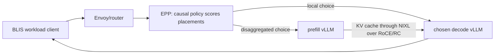

# Session checkpoint: run the causal SLO-externality port on llm-d

Date: 2026-08-27  
Current isolated experiment namespace: `vramani-perfcal`  
Original workspace: `<local experiment workspace>`

## Latest request-keyed observability result

PipelineRun `qwen-causal-observe-r5-20260827` completed all 11 tasks on the
real Qwen3-14B TP=1, 1P2D stack. It sent 20 fixed-512 requests with 15,000
generated input tokens at one request/s. All 20 requests succeeded: 17 were
local and three were disaggregated.

The strict analyzer now resolves the sidecar proxy UUID returned by vLLM back
to the EPP request UUID and rejects any successful client row that is not
joined. Coverage is 20/20 with no duplicate decisions, placement mismatches,
proxy-ID mismatches, missing remote IDs, or missing required events. All 76
candidate decompositions satisfy the five-term iteration law and every TTFT,
completion, externality-sum, and objective identity; the largest numerical
error is `3.64e-12` microseconds.

The prediction comparison is promising but not yet a policy proof:

- local client TTFT: 60.82 ms MAE and 6.87% MAPE across 17 requests;
- remote prefill completion: 31.35 ms MAE and 3.68% MAPE across three;
- early decode-iteration SSE proxy: 5.72% MAPE local and 8.62% remote;
- remote prefill-complete-to-first-token tail: 1.058 s MAE, exposing a large
  transfer/synchronization/admission gap;
- one unambiguous NIXL transfer: 200.627 ms predicted versus 599.502 ms
  observed; and
- eight resident target predictions with no later logged arrival: 151.96 ms
  MAE. The remaining 61 resident rows include later arrivals and cannot be
  treated as counterfactual externality measurements.

The first 11 workload decisions used the output-length estimator's cold-start
value `nHatOut=1`; the remaining nine used 512 after the first completion.
Completion error must therefore be reported on the warm subset. Warm client
completion MAPE is 16.40% for six local requests and 15.21% for three remote
requests.

Full evidence and generated reports are in
`qwen-causal-observe-r5-20260827-results-full/`. The detailed interpretation is
in `CAUSAL-SLO-PREDICTION-VALIDATION-2026-08-27.md`. No object outside
`vramani-perfcal`, no `sluice-*` object, and no image outside
`quay.io/vishakharamani` was changed.

## Latest matched real-system result

The corrected five-term iteration law is now running from the public image
`quay.io/vishakharamani/llm-d-router:causal-qwen-iterlaw-20260827` (runtime
digest `sha256:7d7a9ba382d36bc6673fabf426efdf5bb2d0d257d5953bed7670c7bbec1716fd`).
No Kalantar registry image was modified or used for this custom EPP build.

A matched 40-request causal/stock pair completed on Qwen3-14B TP=1, 1P2D,
one request/s, 15,000 input tokens, and fixed 512 output tokens. Both sides
explicitly disabled prefix caching and every engine reported
`enable_prefix_caching=False`.

- causal: 39/40 completed, 31 local and eight disaggregated choices, 29/40 met
  all configured interactive targets, composite goodput 0.597 request/s;
- stock: 40/40 completed, 40 disaggregated executions, 0/40 met all configured
  targets because every TTFT exceeded the one-second target; and
- the causal candidate trace contains 136 workload rows. The maximum iteration
  identity error is `1.82e-12` microseconds and the score identity error is
  exactly zero.

This is the first positive real-system SLO-goodput pilot. It is not a universal
latency win: stock mean ITL and E2E were better, and the result is sensitive to
the configured TTFT target. Causal also returned one HTTP 429 when the strict
clean-snapshot gate excluded both decoders. See
`QWEN-SLO-EXTERNALITY-COMPARISON-2026-08-27.md` for the complete claim and
caveats. The raw evidence is in
`qwen-iterlaw-{causal,stock}-r1-nopc40-20260827-results/`.

`generate-qwen-iterlaw-run.rb` now always passes
`--no-enable-prefix-caching` and accepts `SEED` in addition to `RATE`,
`REQUESTS`, `INPUT_TOKENS`, and `OUTPUT_TOKENS`.

## Update after resuming this checkpoint

The causal policy has now selected and executed disaggregated placements on
the real llm-d P/D stack. PipelineRun
`causal-qwen-overlap-20260827-151229` completed all 11 tasks. Its 20-request
overlap workload produced 18 local and 2 disaggregated decisions; all 20
requests returned exactly 512 tokens successfully. Each remote choice used a
different decoder, completed one nonzero NIXL transfer with zero failures, and
used `rc_mlx5` for the cross-node KV payload. See
`SLO-EXTERNALITY-PD-VALIDATION-2026-08-27.md` and
`causal-qwen-overlap-20260827-151229-results/` for the claim-bounded report and
raw evidence.

The prepared Llama-70B run was also attempted as
`causal-llama70b-rdma-mintok-20260827-145719`. Its scenario rendered and its
causal EPP loaded, but no model pod could schedule because no H100 node had
four free GPUs. It was canceled through the final cleanup task before any
request was sent. Retry the unchanged Llama scenario when three nodes each
have four free H100s. The next scientific validation task is still a
request-keyed per-candidate trace and fixed-snapshot EPP-versus-simulator
comparison; the successful Qwen run proves execution, not production goodput.

### Practical Qwen stage-0 calibration completed; coverage expansion remains

The immediate experiment has been changed from Llama-70B TP=4 to
Qwen3-14B TP=1. This keeps the real 1P2D topology and NIXL/RDMA data path while
reducing the requirement from 12 H100s to three. Qwen-specific calibration is
mandatory: the successful causal smoke still contains borrowed Llama timing
coefficients and the wrong `kvBytesPerTokenPerGPU` value (81,920 instead of
163,840), so it cannot yet support a routing-quality claim.

One-H100 calibration is prepared in `pd-model-validation/calibration/` for
Qwen3-14B, TP=1, vLLM 0.23.0, 2,048 scheduled tokens per iteration, 16-token
KV blocks, and disabled prefix caching. A reduced smoke completed successfully
in namespace `vramani-perfcal` on 2026-08-27:

- 112 decode timing rows across four `(batch, context)` cells;
- TTFT of 18.76 ms, 86.33 ms, and 191.25 ms for 64, 2,048, and 4,096 prompt
  tokens;
- two observed mixed decode/prefill iterations for the expected two 2,048-token
  chunks; and
- exact SSE accounting: five requested tokens produced five token-ID-bearing
  frames plus `[DONE]`; the last real token also carried
  `finish_reason=length`.

The client now requests streamed token IDs, ignores metadata-only frames,
records the exact run grid in `metadata.json`, and takes three independent
samples per prefill and mixed cell in the full sweep. Ten local calibration
tests pass. The smoke exposed and fixed an OpenShift arbitrary-UID issue in
the client Job by setting `HOME=/tmp` before `pip install`.

The full stage-0 CSVs were copied and fitted under
`pd-model-validation/calibration/results/qwen3-14b-tp1-vllm-0.23.0/stage0/`.
Both calibration deployments are currently scaled to zero. The executable
runbook remains `pd-model-validation/calibration/qwen14b-run.md`; the next
calibration pass is the expanded/repeated grid listed below.

### TODO: establish how reliable the Qwen coefficients are

The calibration follows the intended non-circular methodology. Decode-only
and prefill-only measurements fit the five coefficients; mixed
prefill/decode iterations are held out and used only to test whether the
marginal terms add correctly when both kinds of work share one GPU iteration.
The amount of evidence is uneven:

- decode has 6,048 raw iteration samples across 24 independent
  `(batch, context)` cells. The regression uses one median per cell and gives
  R² 0.9987 and 0.405% MAPE. This is strong evidence inside the measured grid,
  but the largest per-request context was 4,096 tokens while the routing run
  used roughly 15,000-token prompts;
- prefill has only 27 observations (nine prompt lengths times three repeats).
  Its R² is 0.99986 because the curve spans a large dynamic range, but its
  16.36% MAPE shows that the prefill coefficients are not yet precise; and
- mixed validation has 72 held-out rows (three decode batch sizes, three
  repeats, and eight chunks of a 16,000-token prompt) with 6.96% MAPE. This is
  encouraging evidence for the additive iteration law, but its decode batches
  are 8, 16, and 32 while the first real routing run commonly operated around
  four to seven decoder requests.

Do not label the complete Qwen coefficient vector “high confidence” yet. The
next calibration pass must:

1. repeat the prefill-only points enough times to report coefficient confidence
   intervals rather than only one fit and one MAPE;
2. add decode contexts near 8k, 16k, and the configured 32k limit;
3. add held-out mixed batches at 1, 2, 4, and 6 as well as 8, 16, and 32;
4. repeat the grid on fresh H100 pods/nodes and on a second day to expose
   machine and run-to-run variation;
5. report bootstrap confidence intervals and leave-one-cell-out stability for
   every coefficient; and
6. compare predicted iteration time with measured iteration time at the actual
   1P2D routing operating points before claiming that placement quality follows
   from the fitted model.

The present defensible wording is: the decode fit is strong in-grid, the
prefill fit is the main uncertainty, and the held-out mixed result supports the
five-term structure but does not yet establish broad out-of-grid accuracy.

## Start here if this project is new to you

This document is both a handoff and a runbook. You do not need prior knowledge
of the earlier debugging session. Read this section once, then follow **Exact
next experiment** in order. Do not begin with a full performance sweep.

The project asks one research question: can the causal SLO-externality routing
policy make better placement decisions for an LLM service whose prompt work
and token generation run on separate GPU workers?

For one incoming request, the custom policy compares four possibilities in the
prepared topology:

- decode the request locally on decoder 1;
- prefill remotely, then decode on decoder 1;
- decode locally on decoder 2; or
- prefill remotely, then decode on decoder 2.

It predicts the arriving request's SLO benefit and the delay imposed on
requests already running at each candidate. It chooses the smallest value of
`resident externality - arriving request benefit`. The current experiment is
only checking that this translated decision code works correctly inside
llm-d. It is not yet checking whether those predictions are accurate enough to
improve production performance.

### What happens to one request



The EPP chooses the placement. The routing sidecar next to the decoder executes
a disaggregated choice by sending a one-token prefill request, preserving the
client's original generation limits for decode, and coordinating the KV-cache
transfer. vLLM performs the GPU work. NIXL and UCX move the bulk KV payload.

There are **two different custom images**; do not confuse them:

| Image | Job |
|---|---|
| `quay.io/vishakharamani/llm-d-router:causal-qwen-observability-v2-20260827` | EPP binary containing the translated causal policy and request-keyed prediction logging |
| `quay.io/vishakharamani/llm-d-router-disagg-sidecar:causal-qwen-observability-v2-20260827` | Routing sidecar containing the fixed P/D request rewrite, compatible port flag, and request-keyed stage/SSE logging |

### Small glossary

| Term | Meaning here |
|---|---|
| P/D | Prefill/decode disaggregation: one worker computes the prompt KV cache and another generates output tokens |
| EPP | Endpoint Picker: the llm-d component that chooses the decode endpoint and, when useful, a prefill endpoint |
| vLLM | The model server running on each prefill or decode replica |
| Routing sidecar | Proxy beside vLLM that turns an EPP remote-prefill choice into two coordinated requests |
| NIXL | The layer vLLM uses to transfer KV-cache data between prefill and decode workers |
| UCX / RC | The communication library and its reliable-connected RDMA transport used for the KV payload |
| Multus | The Kubernetes mechanism that attaches the RoCE-capable secondary network to each model pod |
| RoCE | RDMA over the cluster's Ethernet fabric |
| TP=4 | One model replica spans four GPUs using tensor parallelism |
| 1P2D | One prefill replica and two decode replicas; at TP=4 this run needs 12 H100 GPUs |
| BLIS | The workload/experiment machinery used by the sim2real Pipeline; it is not the deployed routing stack |
| Scenario | llm-d-benchmark YAML describing model replicas, vLLM flags, networking, images, and EPP configuration |
| PipelineRun | The Tekton object that deploys the scenario, runs the workload, collects evidence, and tears it down |
| SCC | OpenShift security policy needed because these RDMA model containers run with privileged capabilities |

### The minimum safe workflow

1. Check that the shared cluster prerequisites exist and nobody else's model
   run is active.
2. Validate the prepared scenario.
3. Embed it into a uniquely named PipelineRun. The scenario YAML is a
   PipelineRun parameter; do not submit the scenario file directly to
   Kubernetes.
4. Grant the generated Llama service account the required SCC.
5. Submit one fixed-512 request and watch startup.
6. Judge it only against the functional acceptance contract below.
7. Copy logs and rendered resources from `data-pvc` before cleanup/pruning.
8. Remove the temporary SCC grant.

Stop if the generated object differs from the expected 1P2D, TP=4, NIXLv2,
RDMA-only-payload configuration. A failed smoke is diagnostic evidence; do not
change several policy and transport settings at once to make it pass.

## Resume objective (superseded by the practical Qwen path above)

The next session should run a **functional Llama-3.3-70B smoke test of the
causal-SLO-externality EPP policy** on the known-working llm-d P/D and RDMA
plumbing.

Use:

- one prefiller and two decoders;
- TP=4 for every model replica (12 H100 GPUs total);
- NIXLv2 with the KV payload forced onto RoCE/RC;
- the patched routing sidecar;
- a fixed-length `min_tokens=max_tokens=512` request; and
- the `interactive` SLO target.

This first run answers, “Does the translated policy load, make a joint
placement decision, and execute that decision successfully?” It is **not yet a
performance comparison** and must not be presented as evidence that the policy
improves goodput.

## State at the checkpoint

The cluster was checked at the end of this session:

- `oc whoami`: authenticated experiment owner
- The current CLI project was `vllm-test`, so every command below explicitly
  uses `-n kalantar-0`.
- No Qwen, Llama, or `pdinfocomm` model/router deployments, StatefulSets, or
  pods were active in `kalantar-0`.
- No PipelineRuns remained in `kalantar-0`; Tekton pruning removed the
  completed control run.
- `data-pvc-checkpoint` no longer exists.
- `data-pvc`, `source-pvc`, `hf-secret`, `helm-installer`, and the Tekton
  `sim2real` Pipeline are the shared prerequisites. The PVCs and Pipeline were
  present when checked.
- The temporary Quay pull secret and the earlier Qwen privileged-SCC grant were
  removed.
- The patched sidecar image is public, so no `quay-registry-creds` secret is
  needed.

The workspace root itself is not a Git repository. The files listed below are
local handoff artifacts and must be copied or committed deliberately if they
need to be shared.

## What was proved in this session

### RDMA and NIXL plumbing

An always-disaggregated Qwen3-14B 1P1D control test passed:

- All 11 Pipeline tasks succeeded.
- The one client request succeeded with 15,000 generated input tokens, 16,025
  server-observed input tokens, and exactly 512 output tokens.
- Both the prefill and decode roles processed the request.
- NIXL reported one main-request KV transfer: 2,505 “MB” in 285.241 ms, or
  8,782.047 “MB/s.” Its implementation uses binary MiB despite those labels,
  so this is 2,505 MiB at 8,782 MiB/s: 8.58 GiB/s, 9.21 decimal GB/s, or
  73.7 Gbps.
- NIXL transfer failures were zero.
- `UCX_TLS=rc,sm,cuda_ipc,cuda_copy`; `tcp` was not an allowed KV payload
  transport.
- UCX selected `rc_mlx5` for the cross-node GPU-memory path.
- vLLM's load-failure behavior prevented a silent local-decode fallback.

The saved Pod manifests confirm that this was genuinely cross-node:

```text
decode pod   qwen-qwe-079d55ee-wen3-14b-decode-65bfdbccc6-zp66c
decode node  pokprod-b93r39s1
prefill pod  qwen-qwe-079d55ee-wen3-14b-prefill-758858bf5-rsfdm
prefill node pokprod-b93r43s1
```

The reported 2,505 “MB” also has an exact explanation. vLLM 0.23.0 divides
bytes by `2**20` in this log, so the label is technically MiB. The trace's
15,000 generated input tokens became 16,025 server tokens after the 1,000-token
shared prefix and 25 rendered/template tokens were included. With Qwen3-14B's
40 layers, 8 KV heads, 128-dimensional heads, BF16 storage, and separate K and
V tensors, each prompt token requires:

```text
2 (K,V) * 40 layers * 8 KV heads * 128 values * 2 bytes = 163,840 bytes
```

vLLM allocates in 16-token KV blocks, so 16,025 tokens occupy 1,002 blocks, or
16,032 padded token positions. Therefore:

```text
16,032 * 163,840 bytes = 2,626,682,880 bytes = 2,505 MiB exactly
```

The NIXL trace independently corroborates this calculation: it contains
80,160 descriptors of 32,768 bytes each. That is 1,002 blocks times 80 tensors
per block (`40 layers * K,V`). Using only the original 15,000 tokens would
produce 2,345 MiB after block rounding, not 2,505 MiB. The main transfer size
is therefore derived from the full 16,025-token server prompt, rounded to vLLM
blocks—not from the 15,000-token workload field alone.

#### When the KV transfer actually happens

The tested configuration used NIXLv2's serial READ path. It does not transmit
one KV vector as soon as the prefiller creates it. The prefiller first computes
the prompt and fills its local GPU KV blocks. Only after that prefill request
finishes does the decoder pull the completed block set.

```mermaid
sequenceDiagram
    participant C as BLIS client
    participant E as Envoy and EPP
    participant S as Decode-pod sidecar
    participant P as Prefill vLLM
    participant D as Decode vLLM

    C->>E: Streaming request, min=max=512
    E->>E: Choose decode and prefill endpoints
    E->>S: Route to decoder pod with prefiller header
    S->>S: Save original generation settings
    S->>P: Non-streaming prefill request, min=max=1
    loop Prompt chunks, at most 2,048 scheduled tokens here
        P->>P: Run transformer and populate local 16-token KV blocks
    end
    P->>P: Finish one-token prefill request and pin its KV blocks
    P-->>S: Return engine ID, block IDs, request ID, host and port
    S->>S: Restore min=max=512 and streaming
    S->>D: Submit decode request with prefill metadata
    D->>D: Allocate corresponding destination KV blocks
    D->>P: Exchange NIXL agent and registered-memory metadata
    D->>P: Submit asynchronous NIXL READ for the block descriptors
    P-->>D: KV payload moves GPU-to-GPU over UCX rc_mlx5
    D->>D: Poll transfer handle; request waits for remote KV
    D->>D: Mark blocks ready and recompute the final prompt token
    D-->>P: Completion notification permits prefiller block release
    loop 512 generated tokens
        D-->>C: Stream next token through sidecar, Envoy and EPP
    end
    D->>D: Release decoder KV blocks
```

At process startup, each vLLM instance allocates its larger KV-cache arena and
registers that GPU memory with NIXL. For a request, vLLM allocates block IDs
inside those already-registered arenas. A logical 16-token Qwen block spans all
40 transformer layers:

```text
one layer's K region: 16 tokens * 8 KV heads * 128 * 2 bytes = 32,768 bytes
one layer's V region: 16 tokens * 8 KV heads * 128 * 2 bytes = 32,768 bytes
40 layers * two regions                                             = 80 descriptors
one logical block total                              80 * 32,768 = 2.5 MiB
```

The decoder submits one logical asynchronous NIXL transfer containing all
80,160 descriptors. NIXL/UCX may break or coalesce that work into lower-level
RDMA operations; the application log does not expose every network packet.
While the read is in flight, this request is in
`WAITING_FOR_REMOTE_KVS` and cannot decode, although the decoder may run other
requests. Completion is polled between engine steps. On success the decoder
marks the imported blocks usable, and its 512-token generation then extends
the KV cache locally; those output-token KVs are not transferred from the
prefiller.

Two nuances matter when interpreting this timeline:

- The one-token prefill result fits inside the final partially occupied
  16-token block, so byte count alone cannot distinguish 16,025 from 16,026
  valid positions. It does prove a 1,002-block footprint and rules out the
  15,000-token input alone or the full 512-token output as the transfer basis.
- “Asynchronous transfer” means the decoder engine can do unrelated work while
  NIXL runs. It does not mean this request overlaps its prefill and transfer in
  the tested serial path. A separate MoRI-IO parallel WRITE path exists in the
  source but was not enabled in this run.

A read-only cluster check also confirmed the physical link units. The SR-IOV
node state reports `linkSpeed: 100000 Mb/s` for every RoCE-facing `p0`–`p15`
port on the two nodes used by this Qwen run (`pokprod-b93r39s1` and
`pokprod-b93r43s1`). That means **100 Gbps, or 12.5 GB/s theoretical, per
port**. The test set `UCX_MAX_RMA_RAILS=1`, so the payload result should be
compared with one 12.5-GB/s rail, not with all ports added together. In
consistent decimal units it achieved 9.21 GB/s, or 73.7 Gbps—about 74% of that
single-port line rate. The nodes also have a separate 10-Gbps `q0` interface;
that is not the RoCE payload result reported here.

The preserved audit copy is
`always-disagg-rdma-mintok-smoke-results/`. The complete reproduction and
validation commands are in `always-disaggregated-rdma-smoke-test.md`.

This proves the cluster, Multus attachment, sidecar coordination, NIXL, and
RoCE/RC payload path. It does not validate the causal policy or its estimates.

### Routing-sidecar fix

The stock pinned sidecar made the prefill leg internally inconsistent when the
client requested fixed-length output: it changed `max_tokens` to 1 but left
`min_tokens` at 512. The fixed image:

```text
quay.io/vishakharamani/llm-d-router-disagg-sidecar:5f4e762-min-tokens-20260827
sha256:eb50771fbb5dde111e9c4e640ad1fe567da1ffc7acfa0a6eac7347eb6f195885
```

does two required things:

1. The prefill subrequest receives `min_tokens=1,max_tokens=1`.
2. The decode subrequest receives the original
   `min_tokens=512,max_tokens=512`.

It also accepts the modelservice chart's `--model-server-port` argument. The
shareable `llm-d-sidecar-min-tokens-fix.patch` contains both the token fix and
the CLI port-alias change, with their tests. The immutable image digest remains
the exact artifact exercised in the successful cluster run.

### Networking fix

For each prefill/decode pod, the working configuration needs all of the
following:

```yaml
annotations:
  decode:
    pod:
      k8s.v1.cni.cncf.io/networks: openshift-sriov-network-operator/multi-nic-compute
  prefill:
    pod:
      k8s.v1.cni.cncf.io/networks: openshift-sriov-network-operator/multi-nic-compute

vllmCommon:
  kvTransfer:
    connector: NixlConnector
    enabled: true
    role: kv_both
  ucxTls: rc,sm,cuda_ipc,cuda_copy
  networkResource: rdma/roce_gdr
  networkNr: "1"
```

`networkResource` alone only allocates an RDMA device; it does not attach an
RDMA-addressable pod network. The Multus annotation supplies that network.
Omitting `tcp` from `UCX_TLS` makes KV payload transport fail closed instead of
silently falling back to TCP.

HTTP and NIXL metadata/bootstrap traffic still use TCP. The requirement we can
and did prove is **no TCP fallback for the bulk KV payload**, evidenced by
`rc_mlx5` in the UCX protocol trace.

## Fix ledger

| Problem found | Fix carried into the next run | Durable artifact | Verification status |
|---|---|---|---|
| P/D prefill changed `max_tokens` to 1 while retaining `min_tokens=512`, so vLLM rejected it | Cap both fields to 1 only for prefill, then restore the original values for decode | Patched sidecar image and `llm-d-sidecar-min-tokens-fix.patch` | Unit-tested in the source tree and passed the Qwen fixed-512 cluster smoke |
| Modelservice v0.4.16 emits `--model-server-port`, while the pinned v0.9.0 sidecar expected `--vllm-port` | Accept `--model-server-port` as an alias for the same backend-port setting | Patched sidecar image and updated patch file | Unit-tested and observed in the rendered, working Deployment |
| P/D pods had an RDMA resource but no RDMA-addressable pod interface | Attach `openshift-sriov-network-operator/multi-nic-compute` to both roles | Both prepared Llama scenario files | Proven on the Qwen end-to-end control; Llama render still pending |
| Default `UCX_TLS` allowed TCP and excluded RC | Set `UCX_TLS=rc,sm,cuda_ipc,cuda_copy` | Both prepared Llama scenario files | Qwen payload selected `rc_mlx5`; no TCP payload lane |
| `networkResource: auto` obscured what resource was actually requested | Pin `networkResource: rdma/roce_gdr` and `networkNr: "1"` | Both prepared Llama scenario files | Qwen model pods received the RDMA resource |
| The old HCA exclusion list contained `mlxl5_7` and could influence UCX device discovery | Do not carry that brittle exclusion list into the fixed scenario; inspect the preprocessing script's generated `UCX_NET_DEVICES` instead | `scenarioContent-llama70b-causal-slo-rdma-fixed.yaml` | Correct devices were generated in the Qwen control; recheck for Llama |
| Llama prefiller had only a 16-GiB memory limit and was at risk of OOM during model load | Raise it to a 128-GiB limit and 64-GiB request, matching the safer decoder sizing | `scenarioContent-llama70b-causal-slo-rdma-fixed.yaml` | YAML-validated; Llama cluster test pending |
| The routing sidecar was initially private | Publish and pin the tested Quay image by immutable tag/digest; remove `vllmCommon.pullSecret` | Public image plus both prepared Llama scenarios | Anonymous pull worked in the Qwen control |
| Old PipelineRuns still embedded Qwen or pre-fix Llama configuration | Keep a standalone corrected `scenarioContent` and generate a fresh, uniquely named PipelineRun at resume time | Checkpoint generation recipe plus `scenarioContent-llama70b-causal-slo-rdma-fixed.yaml` | Generated object passed YAML parsing and server-side PipelineRun dry-run |
| Privileged SCC state was easy to leave behind or apply to the wrong generated account | Derive and record the Llama account `meta-lla-888e33f1-instruct`, grant before the run, and remove afterward | This checkpoint | Name verified against the pinned benchmark's naming code; execution pending |
| Completed Tekton objects can be pruned before later inspection | Copy results from `data-pvc`, save rendered resources/raw logs, and capture the EPP log live | Control audit directory and checkpoint commands | Worked for the Qwen control |

## Prepared artifacts

| File | Purpose/status |
|---|---|
| `scenarioContent-llama70b-causal-slo-rdma-fixed.yaml` | Next causal-policy scenario. Prepared and syntax-validated, but not yet rendered or run on the cluster. |
| `scenarioContent-llama70b-always-disagg-rdma.yaml` | Llama always-disaggregated control scenario. Prepared but not cluster-tested. |
| `pipelinerun-causal-rdma-mintok-smoke.yaml` | Known-working PipelineRun shape and fixed-512 workload; still contains the Qwen scenario and must not be submitted unchanged. |
| `always-disaggregated-rdma-smoke-test.md` | Full runbook and acceptance checks for the already-passed forced-disaggregation control. |
| `always-disagg-rdma-mintok-smoke-results/` | Local audit copy of that successful control run. |
| `pokprod.md` | Cluster networking investigation, raw RDMA/NIXL benchmark findings, and transport conclusions. |
| `llm-d-porting-explanation.md` | Detailed mapping from the mathematical algorithm to EPP/vLLM state, plus known fidelity limitations. |
| `llm-d-sidecar-min-tokens-fix.patch` | Complete source patch for the `min_tokens` fix and `--model-server-port` compatibility alias, including tests. |

The prepared causal scenario was validated as both outer YAML and embedded EPP
plugin YAML. Its load-bearing values are:

```text
model                         meta-llama/Llama-3.3-70B-Instruct
topology                      1 prefiller, 2 decoders, TP=4 each
prefill resources             limit 128 GiB/32 CPU, request 64 GiB/16 CPU
EPP image                     ghcr.io/kalantar/llm-d-router:07f0062216a4-causalsloexternality
routing sidecar               quay.io/vishakharamani/llm-d-router-disagg-sidecar:5f4e762-min-tokens-20260827
connector                     nixlv2 / NixlConnector / kv_both
UCX_TLS                       rc,sm,cuda_ipc,cuda_copy
RDMA resource                 rdma/roce_gdr
EPP profile                   one role-blind joint profile
expected candidates           2 local + 2 disaggregated
active SLO targets            interactive
chunkTokens                   2048
engine/policy blockSize       16
maxBatchSize                  256
policy switches               noCapacity=true; all other ablations=false
configured transfer bandwidth 25 GB/s (not yet calibrated to this deployment)
```

Validation so far covers YAML parsing and internal field checks. It does not
prove that the benchmark renderer accepts every field or that the EPP binary
starts successfully.

## Deferred exact Llama experiment

### 1. Enter the workspace and check prerequisites

```bash
cd /path/to/your/experiment-workspace

export NS=kalantar-0
export SCENARIO="$PWD/scenarioContent-llama70b-causal-slo-rdma-fixed.yaml"
export TEMPLATE="$PWD/pipelinerun-causal-rdma-mintok-smoke.yaml"
export RUN="causal-llama70b-rdma-mintok-$(date +%Y%m%d-%H%M%S)"
export EXPERIMENT_ID="$RUN"
export PHASE=causalsloexternality-rdma-llama70b-mintok-smoke
export GENERATED="$PWD/${RUN}.yaml"
export RESULT_DIR="$PWD/${RUN}-results"

oc whoami
oc -n "$NS" get pipeline.tekton.dev sim2real
oc -n "$NS" get serviceaccount helm-installer
oc -n "$NS" get pvc data-pvc source-pvc
oc -n "$NS" get secret hf-secret
```

Confirm that no other model run is active. Do not remove another person's
resources:

```bash
oc -n "$NS" get deploy,statefulset,pod
oc -n "$NS" get pipelinerun
```

### 2. Revalidate the scenario

```bash
yq '.' "$SCENARIO" >/dev/null

yq -r \
  '.scenario[0].router.epp.pluginsCustomConfig."custom-plugins.yaml"' \
  "$SCENARIO" > /tmp/causal-epp-validation.yaml

yq '.' /tmp/causal-epp-validation.yaml >/dev/null

yq '.scenario[0].decode.replicas,
    .scenario[0].prefill.replicas,
    .scenario[0].decode.parallelism.tensor,
    .scenario[0].prefill.parallelism.tensor,
    .scenario[0].vllmCommon.kvTransfer,
    .scenario[0].vllmCommon.ucxTls,
    .scenario[0].vllmCommon.networkResource,
    .scenario[0].images.routingSidecar' \
  "$SCENARIO"
```

Expected: `2`, `1`, `4`, `4`, enabled `NixlConnector/kv_both`, an `UCX_TLS`
list with `rc` and without `tcp`, `rdma/roce_gdr`, and the patched public
sidecar tag.

### 3. Generate a unique Llama PipelineRun

Do not submit `pipelinerun-causal-rdma-mintok-smoke.yaml` directly; its embedded
scenario and model parameter are still Qwen. Generate a new object from it:

```bash
ruby -ryaml -e '
  document = YAML.safe_load(File.read(ENV.fetch("TEMPLATE")))

  document.fetch("metadata")["name"] = ENV.fetch("RUN")
  document.fetch("metadata")["namespace"] = ENV.fetch("NS")
  document.delete("status")

  document.fetch("spec").fetch("params").each do |param|
    case param.fetch("name")
    when "experimentId", "runName"
      param["value"] = ENV.fetch("EXPERIMENT_ID")
    when "namespace"
      param["value"] = ENV.fetch("NS")
    when "phase"
      param["value"] = ENV.fetch("PHASE")
    when "scenarioContent"
      param["value"] = File.read(ENV.fetch("SCENARIO"))
    when "model"
      param["value"] = "meta-llama/Llama-3.3-70B-Instruct"
    when "maxConcurrency"
      param["value"] = "1"
    when "warmupRequests"
      param["value"] = "0"
    when "prewarmDuration"
      param["value"] = "0s"
    end
  end

  File.write(ENV.fetch("GENERATED"), YAML.dump(document))
'
```

The template already supplies one request with a 15,000-token generated input
and a Gaussian output distribution fixed at 512 (`min=mean=max=512`, standard
deviation zero). This is the normal BLIS constrained-output path that exercises
the sidecar fix.

Validate the generated object and its embedded scenario:

```bash
yq '.' "$GENERATED" >/dev/null

yq -r '.spec.params[] | select(.name == "scenarioContent") | .value' \
  "$GENERATED" > /tmp/causal-llama70b-scenario-check.yaml

yq '.' /tmp/causal-llama70b-scenario-check.yaml >/dev/null

yq -r '.spec.params[] |
  select(.name == "model" or .name == "maxConcurrency" or
         .name == "workloadSpec") |
  [.name, .value] | @tsv' "$GENERATED"

oc -n "$NS" create --dry-run=server -f "$GENERATED" -o name
```

The server dry-run validates the PipelineRun object, but the scenario schema is
only fully exercised by the benchmark standup task.

### 4. Grant the model service account the required SCC

At this pinned benchmark commit, the model label/service-account name is the
first eight normalized model characters, eight SHA-256 characters from
`namespace/normalized-model`, and the last eight model characters. For this
namespace and model it is:

```text
meta-lla-888e33f1-instruct
```

Set and verify it rather than copying an old Qwen account name:

```bash
export MODEL_SA=meta-lla-888e33f1-instruct

oc adm policy add-scc-to-user privileged \
  -z "$MODEL_SA" \
  -n "$NS"
```

The benchmark's standup code also attempts an SCC assignment when it sees
`runAsUser: 0`; the explicit grant keeps this run independent of whether that
step recognizes the scenario. The grant can name the service account before
Helm creates it.

### 5. Submit and watch the functional smoke test

```bash
oc -n "$NS" create -f "$GENERATED"

oc -n "$NS" get taskrun \
  -l "tekton.dev/pipelineRun=$RUN" \
  -w
```

Useful checks in another terminal:

```bash
oc -n "$NS" get pods -o wide -w
```

```bash
STANDUP_POD="$(oc -n "$NS" get pod \
  -l "tekton.dev/pipelineRun=$RUN,tekton.dev/pipelineTask=llmdbenchmark-standup" \
  -o jsonpath='{.items[0].metadata.name}')"

oc -n "$NS" logs -f "$STANDUP_POD" -c step-standup
```

Once the router exists, capture the EPP log live because the PipelineRun may be
pruned soon after completion:

```bash
EPP_POD="$(oc -n "$NS" get pod -o name | rg 'llama.*router-epp' | head -1)"
oc -n "$NS" logs -f "$EPP_POD" -c epp | tee "${RUN}-epp-live.log"
```

The complete run may take substantially longer than the Qwen smoke because it
loads three TP=4 Llama-70B replicas. Scheduling delay is not itself an
algorithm failure.

### 6. Functional acceptance contract

The run passes the **port/plumbing gate** only if all of these hold:

1. The custom EPP image starts and the effective configuration contains both
   `causal-slo-externality` and `causal-slo-externality-picker` in that order.
2. EPP discovers two decode endpoints and one prefill endpoint. The joint
   picker evaluates four placements: two local and two disaggregated.
3. EPP emits the selected candidate, its selected `J`, placement type, and
   chosen endpoint(s), without tokenization, block-size, or unknown-GPU
   failures.
4. The client request finishes with `status=ok`, `finish_reason=length`, and
   exactly 512 output tokens.
5. The deployed routing sidecar is the patched Quay image and receives the
   chart-compatible `--model-server-port=8200` argument.
6. Both vLLM roles have the Multus network annotation, request
   `rdma/roce_gdr`, and have `UCX_TLS=rc,sm,cuda_ipc,cuda_copy`.
7. If the policy chooses a disaggregated placement, the EPP result contains a
   prefiller header, both roles handle the request, NIXL reports a nonzero
   transfer with zero transfer/notification failures, the decoder reports an
   external-prefix-cache hit, and UCX reports an `rc_mlx5` payload lane.
8. If the policy chooses local decode, record that as the algorithm's valid
   decision. Do not falsely claim that this particular request re-tested the
   remote branch; the already-passed always-disaggregated run remains the
   transport control.
9. There is no silent fallback. For a remote selection, a failed KV load must
   fail the request rather than recompute locally.

The existing plugin exports useful aggregate counters:

```text
llm_d_epp_causal_slo_externality_ttft_estimator_substitution_total
llm_d_epp_causal_slo_externality_tokenization_unavailable_total
llm_d_epp_causal_slo_externality_prefix_unobserved_total
llm_d_epp_causal_slo_externality_placement_total
llm_d_epp_causal_slo_externality_candidate_rejected_total
llm_d_epp_causal_slo_externality_block_size_mismatch_total
llm_d_epp_causal_slo_externality_argmin_duration_seconds
llm_d_epp_causal_slo_externality_shadow_table_requests
llm_d_epp_causal_slo_externality_shadow_table_reaped_total
```

The deployed pilot image logs every candidate's mathematical decomposition,
but it does not log the sidecar stage boundaries needed to compare those
predictions with proxy-observed execution. Therefore the completed pilot proves
execution and algebraic identities, but cannot by itself establish
prediction-versus-observation accuracy.

### 7. Preserve results

The result path follows the same convention as the passed control:

```bash
export RESULT_REL="$EXPERIMENT_ID/$PHASE/interactive-chat-single-turn/i1"
```

Use section 5 of `always-disaggregated-rdma-smoke-test.md` to mount `data-pvc`
with the temporary `data-pvc-inspect` pod, then copy:

```bash
mkdir -p "$RESULT_DIR"
oc -n "$NS" cp \
  "data-pvc-inspect:/data/$RESULT_REL/." \
  "$RESULT_DIR"

find "$RESULT_DIR" -maxdepth 3 -type f | sort
```

At minimum preserve:

- `trace_data.csv` and `trace_header.yaml`;
- EPP logs;
- prefill and both decoder vLLM logs;
- raw and processed metrics;
- rendered Deployment and Pod YAML;
- the generated PipelineRun YAML; and
- the live EPP log if it contains details missed by the periodic collector.

Then apply the transport and response checks in sections 6–10 of
`always-disaggregated-rdma-smoke-test.md`, adjusting file globs for two decode
pods.

### 8. Cleanup

The pipeline teardown should remove the Llama deployments. Verify that before
removing the temporary access grant:

```bash
oc -n "$NS" get deploy,statefulset,pod | rg -i 'llama|pdinfocomm' || true

oc adm policy remove-scc-from-user privileged \
  -z "$MODEL_SA" \
  -n "$NS"

oc -n "$NS" delete pod data-pvc-inspect --ignore-not-found
```

Do not delete the shared `data-pvc`, `source-pvc`, `hf-secret`, or
`helm-installer` account.

## What to do after the first causal smoke

If it passes, the next step is a small controlled behavior run—not immediately
the headline baseline-versus-treatment experiment:

1. Send enough fixed-512 requests to get past the output-length estimator's
   one-token cold start and create overlapping residents.
2. Confirm both decoders are considered and that local/disaggregated decisions
   change for understandable score reasons.
3. Add or enable a request-keyed decision trace before making scientific
   claims. It should record every candidate's endpoint snapshot, admission
   estimate, prefill/decode work, transfer estimate, TTFT, arrival completion,
   resident completion changes, `ownGood`, resident externality, final `J`, and
   selected pair.
4. Compare the EPP and reference implementation on identical frozen snapshots.
5. Calibrate the model inputs on this exact Llama/vLLM/TP/chunking setup.
6. Only then compare the causal policy against an otherwise identical baseline
   across repeated seeds and offered loads.

If the first run fails before sending a request, first inspect the standup pod,
EPP startup log, image pull, SCC, GPU scheduling, and rendered YAML. If the
request fails only after a remote choice, inspect the sidecar request rewrite,
NIXL failure counters, generated `UCX_NET_DEVICES`, Multus interfaces, and UCX
protocol table. If it succeeds locally but never selects remote, inspect the
policy inputs and scores before changing transport settings.

## Scientific caveats to keep visible

These are known limitations, not reasons to abandon the first smoke:

- **Transfer model mismatch:** the policy still assumes 25 GB/s and a 50-us
  base cost. The cluster reports 100-Gbps RoCE ports, whose single-port raw
  ceiling is 12.5 GB/s. Correcting vLLM's misleading MB label, the Qwen
  end-to-end run measured about 9.21 decimal GB/s (8.58 GiB/s), while
  standalone NIXLBench reported roughly 10.25–10.98 GB/s for 1–8 MiB
  operations. Measure the actual Llama transfer curve before interpreting
  placement quality.
- **Coefficient provenance:** the current generated H100 coefficients are
  fitted to deterministic BLIS step traces, not the paper's real-vLLM fit. The
  paper's real-vLLM coefficients were measured with vLLM 0.11.0, prefix caching
  disabled, and an 8,192-token budget; this deployment uses a different vLLM
  path, prefix caching, and a 2,048-token budget. Neither set should be treated
  as universally correct without cluster validation.
- **Iteration-state observability:** `vllm:num_requests_running` is not
  phase-specific, and vLLM does not export scheduled prefill grants or their
  attention contexts. The controlled port now rejects decoder snapshots that
  contain a prefill resident and requires a dedicated prefiller to be idle.
  This preserves a meaningful five-term calculation but can reject every
  decoder under load; production use still needs phase-specific inputs or a
  proxy fitted to the exported aggregates.
- **Admission approximation:** the exact scheduler rollout is unavailable at
  this llm-d pin. The plugin always uses a closed-form substitute. Its fast
  path does not check whether the waiting queue is empty, and one prefiller
  fallback path appears to mix remaining tokens with remaining iterations.
- **Output-length cold start:** each SLO-class running mean starts near one
  token, so the earliest decisions may underprice a 512-token arrival. Treat
  the first request as functional validation and warm the estimator before a
  policy comparison.
- **Prefix granularity:** the approximate EPP prefix index uses 64-token blocks
  while vLLM KV capacity accounting uses 16-token blocks. This is not a direct
  4x unit error, because both are converted back to tokens, but it can
  overestimate the uncached suffix by up to 48 tokens from granularity alone
  and can change close decisions. Keep the same prefix producer in baseline
  and treatment.
- **Counterfactual gap:** request-keyed candidate and per-resident traces now
  exist, but one selected execution still cannot reveal how a resident would
  have completed without the arrival. A fixed-snapshot replay or paired run is
  still required to validate causal externality rather than selected-world
  target prediction.

The current clean interpretation sequence is:

```text
passed forced-disaggregation control
    -> Qwen causal-policy functional smoke (passed)
    -> request-keyed prediction study (passed mechanically; model gaps found)
    -> warm-output, repeated transfer/admission validation
    -> fixed-snapshot decision and resident-counterfactual validation
    -> controlled baseline-versus-treatment experiment
```

## Observability implementation (deployed and validated)

The original detached router worktree now has
request-keyed EPP and NIXLv2 sidecar logging under schema
`causal-slo-externality/v1`. No upstream branch, issue, pull request, or image
outside Vishakha's Quay namespace was changed.

The EPP records every candidate, the selected candidate, every resident's
baseline/candidate prediction and marginal contribution, first token, and
completion. The sidecar records request receipt, prefill dispatch/completion,
decode dispatch, first SSE event, subsequent SSE event gaps, and completion.
Both the incoming EPP request ID and sidecar-generated vLLM UUID are retained.

The local analyzer is `analyze-causal-observability.py`; its tests are in
`test-analyze-causal-observability.py`. The event contract, formulas,
measurement classifications, and experiment sequence are documented in
`CAUSAL-SLO-PREDICTION-VALIDATION-2026-08-27.md`.

The amd64 images are public in Vishakha's Quay namespace:

- EPP: `quay.io/vishakharamani/llm-d-router:causal-qwen-observability-v2-20260827`
  (`sha256:00634bf69e44bdc79b6e0253b864003eb4f752cd1304d5afd24578fda0f3efc1`)
- sidecar: `quay.io/vishakharamani/llm-d-router-disagg-sidecar:causal-qwen-observability-v2-20260827`
  (`sha256:bee5b968a5892782c7cb3cb03a9b26fb109391896c6113d5d0010b1ab234e134`)

The EPP v2 image includes the final per-resident SLO/value fields. The sidecar
v2 image adds verbosity-4 SSE events and preserves/restores `min_tokens`
correctly across the prefill and decode legs. Focused Go race tests and four
analyzer unit tests pass. Runs r4 and r5 deployed these exact runtime digests
only in `vramani-perfcal`; r5 is the first run with complete local, remote, and
per-token joins. The next run must warm the `standard` class output estimate,
repeat isolated 15k-token transfers across nodes, and separate NIXL time from
the remaining decode admission/synchronization tail before a matched policy
comparison.
